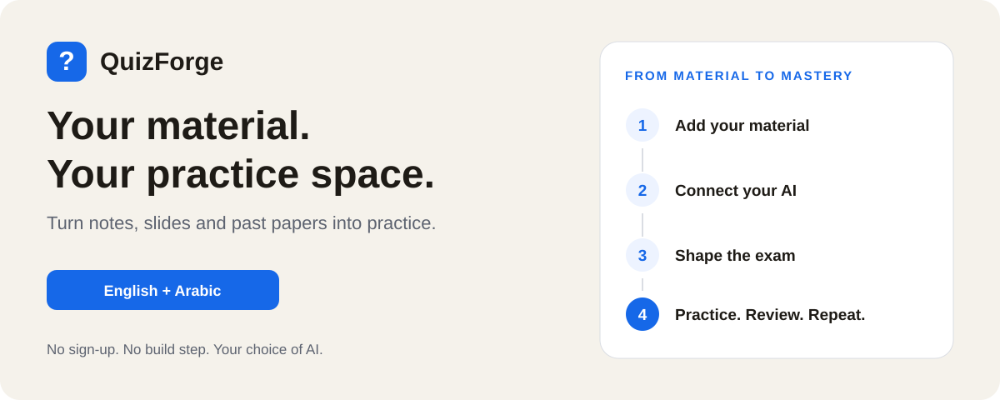

# QuizForge



**Turn notes, slides and past papers into practice exams. Then drill what you miss until it sticks.**

[Use it online](https://estawarbassem-prog.github.io/practice-quiz-builder/) · [Run it locally](#run-it-locally) · [What's inside](#whats-inside) · [Privacy & limits](#privacy--limitations) · [العربية](#العربية)

No sign-up. No build step. No backend. Your exams stay in your browser, and you choose the AI provider. English and Arabic (right-to-left) throughout, light and dark, phone to desktop. MIT licensed.

| Build | Practice | Review |
| --- | --- | --- |
|  |  |  |

## How it works

1. **Build.** Drop in PDF, Word, PowerPoint or text, paste notes, or import a webpage. Already have questions? Import JSON or CSV/XLSX and skip the AI step.
2. **Connect a provider.** Use your own Gemini, OpenAI, Claude or OpenAI-compatible key. Pick question types, difficulty, language and focus.
3. **Practice.** Multiple choice, true/false, fill-in, essays, matching, ordering and sandboxed coding tasks, with timers, strict mode and read-aloud.
4. **Review.** Missed questions come back through smart review, flashcards and a mistake-based exam. Progress shows accuracy by topic.

Try it with no key at all: open **Library** and take the built-in demo exam (16 C pointers and linked-list questions).

## Run it locally

```bash
git clone https://github.com/estawarbassem-prog/practice-quiz-builder.git
cd practice-quiz-builder
python3 -m http.server 8000
```

Open <http://localhost:8000>. Any static file host works the same way.

> AI generation uses your provider's API and may spend your credits. QuizForge ships no API key and no credits. Check generated answers against your course material.

## What's inside

- **Question types:** multiple choice, true/false, fill-in-the-blank, essay, matching, ordering, coding.
- **Study tools:** per-question timers, strict exam mode, flashcards, mistake-based exams, chat with your material, cheat sheets, past-exam analysis.
- **Your library:** exams saved on your device, JSON and CSV/XLSX import, library backup, share-by-link, printing.
- **Made for everyone:** English and Arabic with RTL layouts, light and dark themes, offline app shell, installable as an app.

<details>
<summary>More screenshots: Arabic on a phone and dark theme</summary>

| Arabic, phone | Dark theme |
| --- | --- |
|  |  |

</details>

## Privacy & limitations

- **Local storage:** exam banks, settings and attempt history are kept in this browser. Export a library backup before clearing browser data or moving devices.
- **AI requests:** generation and other AI features send the relevant material and your key to the provider or proxy you configure. A proxy can see requests sent through it. Use only one you trust.
- **Keys:** a saved key lives in browser storage, not a server-side secret store. Avoid saving it on a shared device. Revoke it with your provider if it is exposed.
- **Webpages:** the optional public reader service receives the URL only when you opt in. If fetching fails, paste the page text instead.
- **Offline:** saved exams and local practice features work after the app shell has been cached. AI features and webpage fetching need a connection. Some document readers load from a CDN on first use.
- **Provider support:** availability, pricing, model IDs and browser/CORS support depend on the provider. Claude may need a configured proxy. No live provider calls are part of the demo.
- **Voice and install:** speech recognition, read-aloud voices and PWA installation depend on browser and device support.

## Project map

```text
index.html       App shell and navigation
style.css        Warm paper / blue theme, dark mode and responsive layouts
i18n.js          English and Arabic interface strings
app.js           Imports, generation, library, exams and review
polish.js        Presentation-only import disclosures and step semantics
questions.json   Included 16-question demo bank
sw.js            Versioned offline app-shell cache
manifest.json    Installable-app metadata
docs/            Question-bank format and feature screenshots
CHANGELOG.md     Release history
```

There is no package install or build step. For imported or generated banks, see the [question-bank format](docs/question-bank-format.md).

### Development checks

```bash
node --check app.js
node --check i18n.js
node --check sw.js
```

Before submitting a change, try both languages, both themes and a phone-sized viewport. Check upload/paste, the demo exam, library and stats. Bump the cache version in `sw.js` when changing the app shell so existing installations receive the update.

### Optional hosting

Serve these static files with a host of your choice. GitHub Pages can serve the repository root, but must be enabled separately in the repository settings. This visual refresh does not enable hosting or change deployment settings.

## Project map

```text
index.html       App shell: studio header, navigation, footer
style.css        QuizForge Studio theme: light, dark, responsive, RTL-safe
i18n.js          English and Arabic interface strings
app.js           Imports, generation, library, exams and review
polish.js        Presentation-only import disclosures and step semantics
questions.json   Included 16-question demo bank
sw.js            Versioned offline app-shell cache
manifest.json    Installable-app metadata
icon.svg         App icon
docs/            Question-bank format and screenshots
CHANGELOG.md     Release history
```

There is no package install or build step. For imported or generated banks, see the [question-bank format](docs/question-bank-format.md).

### Development checks

```bash
node --check app.js
node --check i18n.js
node --check sw.js
```

Before submitting a change, try both languages, both themes and a phone-sized viewport. Check upload/paste, the demo exam, library and progress. Bump the cache version in `sw.js` when the app shell changes so installed copies update.

### Hosting

QuizForge is plain static files. The live copy is served by GitHub Pages from the `main` branch root. Fork it and enable Pages in your own repository settings, or use any static host.

## Contributing

Keep changes dependency-light and accessible. Add English and Arabic strings together, preserve translation placeholders, and check right-to-left layouts. Questions should include a topic, a checked answer and a useful explanation.

See the [changelog](CHANGELOG.md) for project history and [LICENSE](LICENSE) for the MIT license.

---

<div dir="rtl" lang="ar">

## العربية

### ذاكر بذكاء، وتذكّر لفترة أطول.

**QuizForge** يحوّل ملاحظاتك وشرائح المحاضرات والامتحانات السابقة إلى امتحانات تدريبية، ثم يعيد عليك الأسئلة التي أخطأت فيها حتى تثبت. الواجهة بالعربية والإنجليزية، مع وضع داكن وتصميم يناسب الموبايل.

**للتجربة بدون مفتاح API:** افتح **المكتبة** واختر الامتحان التجريبي. لإنشاء امتحان من مادتك، أضف الملفات أو النص، ثم اختر مزود الذكاء الاصطناعي ومفتاحك. استيراد بنوك الأسئلة وجداول البيانات لا يحتاج إلى مفتاح.

**خصوصيتك:** تُحفظ الامتحانات والإعدادات في متصفحك على جهازك. عند استخدام ميزات الذكاء الاصطناعي، تُرسل المادة والمفتاح إلى المزود أو الوكيل الذي تختاره. قد يستهلك التوليد رصيدًا مدفوعًا عند المزود، والمفتاح مسؤوليتك. راجع الإجابات الناتجة مع مادتك، وصدّر نسخة احتياطية قبل مسح بيانات المتصفح.

للتشغيل محليًا: `python3 -m http.server 8000` داخل مجلد المشروع، ثم افتح `http://localhost:8000`.

</div>
