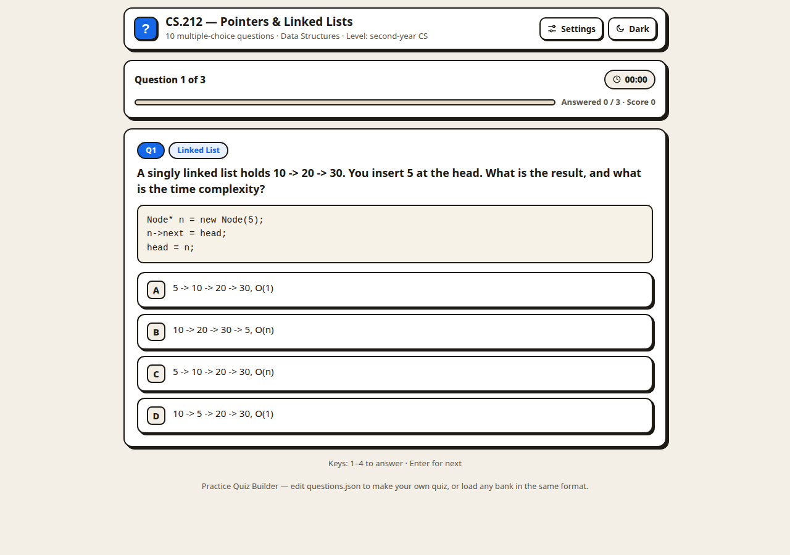
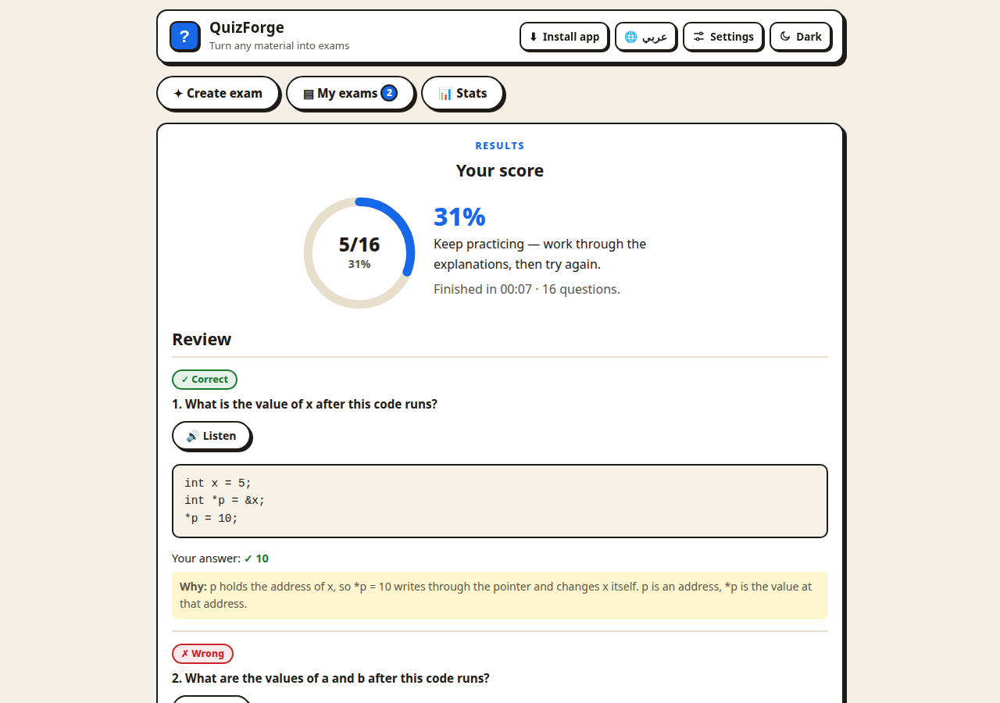

# QuizForge

### Your material. Your practice space.

Turn notes, slides and past papers into practice exams, then learn from the questions you miss. Built with plain JavaScript, with a complete **English / العربية** interface.

[Get started](#get-started) · [What you can do](#what-you-can-do) · [Privacy & limitations](#privacy--limitations) · [العربية](#العربية)


**No sign-up · No build step · Your choice of AI provider · MIT licensed**

## Get started

Clone or download the repository, then serve the folder locally:

```bash
git clone https://github.com/estawarbassem-prog/practice-quiz-builder.git
cd practice-quiz-builder
python3 -m http.server 8000
```

Open <http://localhost:8000> in your browser.

- **Try it without an API key:** open **My exams** and choose **Take the demo exam**. The included bank has 16 C pointers and linked-list questions.
- **Create from your material:** upload files or paste text, choose your AI provider and key, set up the exam, then generate.
- **Already have questions?** Import a JSON bank or CSV/XLSX spreadsheet. No AI key is needed for these imports.

> AI generation uses your provider's API and may use paid credits. QuizForge does not include an API key or provider credits. Review generated answers against your course material.

## What you can do

| Start with | Practice with | Learn from |
| --- | --- | --- |
| PDF, Word, PowerPoint or text | Multiple choice and true/false | Explanations and topic accuracy |
| Notes pasted into the browser | Essays and fill-in-the-blank | Smart review of missed questions |
| Webpage text, where fetching is allowed | Matching and ordering | Flashcards and a mistake-based exam |
| JSON banks or CSV/XLSX questions | Sandboxed JavaScript coding tasks | Attempt history and progress stats |

Also included: per-question timers, strict exam mode, device read-aloud, voice answers where supported, printing, exam links, translation, library backup, and a dark theme.

### A shorter path to practice

1. **Add material.** Upload files or paste your notes. Webpage and spreadsheet imports sit in expandable sections to keep the main screen focused.
2. **Connect your provider.** Choose Gemini, OpenAI, Claude, or an OpenAI-compatible endpoint. Model IDs are editable; use a model your provider currently supports.
3. **Shape the exam.** Choose question count, types, difficulty, language and focus notes.
4. **Practice and review.** Generated exams are saved in **My exams** on this device.

## English and Arabic, light and dark

Switch language from the header. The Arabic interface uses right-to-left layouts, while code and URLs stay left-to-right. The layout adapts to phones and larger screens without external fonts or a UI framework.

<details>
<summary>Explore the feature screenshot gallery</summary>

These captures document the existing feature flows. Some show the earlier visual theme; the preview above shows the current create screen.

| Take an exam | Review results | Use Arabic |
| --- | --- | --- |
|  |  |  |

| Library | Flashcards | Stats |
| --- | --- | --- |
|  |  |  |

More captures are in [docs/screenshots](docs/screenshots/).

</details>

## Privacy & limitations

- **Local storage:** exam banks, settings and attempt history are kept in this browser. Export a library backup before clearing browser data or moving devices.
- **AI requests:** generation and other AI features send the relevant material and your key to the provider or proxy you configure. A proxy can see requests sent through it. Use only one you trust.
- **Keys:** a saved key lives in browser storage, not a server-side secret store. Avoid saving it on a shared device. Revoke it with your provider if it is exposed.
- **Webpages:** the optional public reader service receives the URL only when you opt in. If fetching fails, paste the page text instead.
- **Offline:** saved exams and local practice features work after the app shell has been cached. AI features and webpage fetching need a connection. Some document readers load from a CDN on first use.
- **Provider support:** availability, pricing, model IDs and browser/CORS support depend on the provider. Claude may need a configured proxy. No live provider calls are part of the demo.
- **Voice and install:** speech recognition, read-aloud voices and PWA installation depend on browser and device support.

## Project map

```text
index.html       App shell and navigation
style.css        Warm paper / blue theme, dark mode and responsive layouts
i18n.js          English and Arabic interface strings
app.js           Imports, generation, library, exams and review
polish.js        Presentation-only import disclosures and step semantics
questions.json   Included 16-question demo bank
sw.js            Versioned offline app-shell cache
manifest.json    Installable-app metadata
docs/            Question-bank format and feature screenshots
CHANGELOG.md     Release history
```

There is no package install or build step. For imported or generated banks, see the [question-bank format](docs/question-bank-format.md).

### Development checks

```bash
node --check app.js
node --check i18n.js
node --check sw.js
```

Before submitting a change, try both languages, both themes and a phone-sized viewport. Check upload/paste, the demo exam, library and stats. Bump the cache version in `sw.js` when changing the app shell so existing installations receive the update.

### Optional hosting

Serve these static files with a host of your choice. GitHub Pages can serve the repository root, but must be enabled separately in the repository settings. This visual refresh does not enable hosting or change deployment settings.

## Contributing

Keep changes dependency-light and accessible. Add English and Arabic strings together, preserve translation placeholders, and check right-to-left layouts. Questions should include a topic, a checked answer and a useful explanation.

See the [changelog](CHANGELOG.md) for project history and [LICENSE](LICENSE) for the MIT license.

---

<div dir="rtl" lang="ar">

## العربية

### مادتك الدراسية، بطريقتك.

**QuizForge** يحوّل ملاحظاتك وشرائح المحاضرات والامتحانات السابقة إلى اختبارات تدريبية، ويساعدك على مراجعة الأخطاء. الواجهة متاحة بالعربية والإنجليزية، مع وضع داكن وتصميم مناسب للموبايل.

**للتجربة من غير مفتاح API:** افتح **امتحاناتي** واختر الامتحان التجريبي. لإنشاء امتحان من مادتك، أضف الملفات أو النص، ثم اختر مزود الذكاء الاصطناعي ومفتاحك وإعدادات الامتحان. استيراد بنوك الأسئلة وجداول البيانات لا يحتاج إلى مفتاح.

**خصوصيتك:** تُحفظ الامتحانات والإعدادات في المتصفح على جهازك. عند استخدام ميزات الذكاء الاصطناعي، تُرسل المادة المطلوبة والمفتاح إلى المزود أو الوكيل الذي تضبطه. قد يستهلك التوليد رصيدًا مدفوعًا عند المزود. راجع الإجابات الناتجة مع مادتك الدراسية، وصدّر نسخة احتياطية قبل مسح بيانات المتصفح.

للتشغيل محليًا، استخدم الأمر `python3 -m http.server 8000` داخل مجلد المشروع، ثم افتح `http://localhost:8000`.

</div>
