# QuizForge — Turn any material into exams

[](LICENSE)


QuizForge turns **any material into an exam** — any subject, any person. Upload your PDFs, past exams, slides or notes, paste in **your own** AI API key, describe the exam you want, and take a ready-made quiz in seconds. No account, no server, no build step: a static site that runs entirely in your browser (free on GitHub Pages). It started as Practice Quiz Builder, a small app with a verified C pointers / linked-list bank — that bank is still here as the built-in demo, now **16 questions** (10 multiple-choice, 3 true/false, 1 matching, 1 ordering, 1 coding), playable with no key at all.

## Screenshots

### Create an exam

| Upload material | Your AI key | Exam settings |
|---|---|---|
|  | 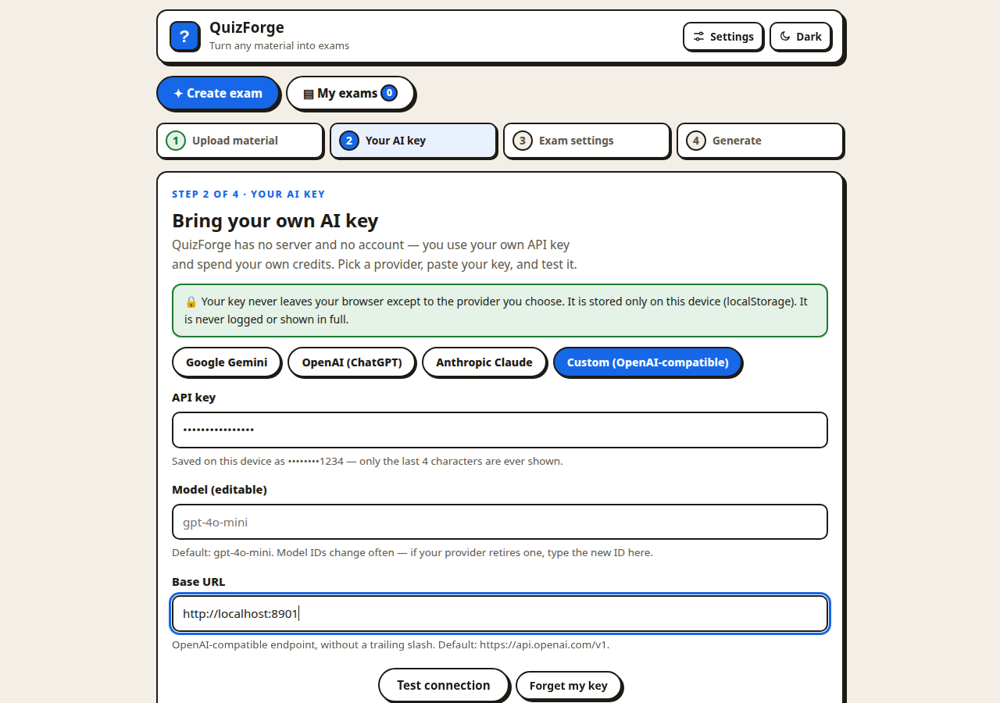 |  |

| Generate | Material summary | From a link | In the library |
|---|---|---|---|
| 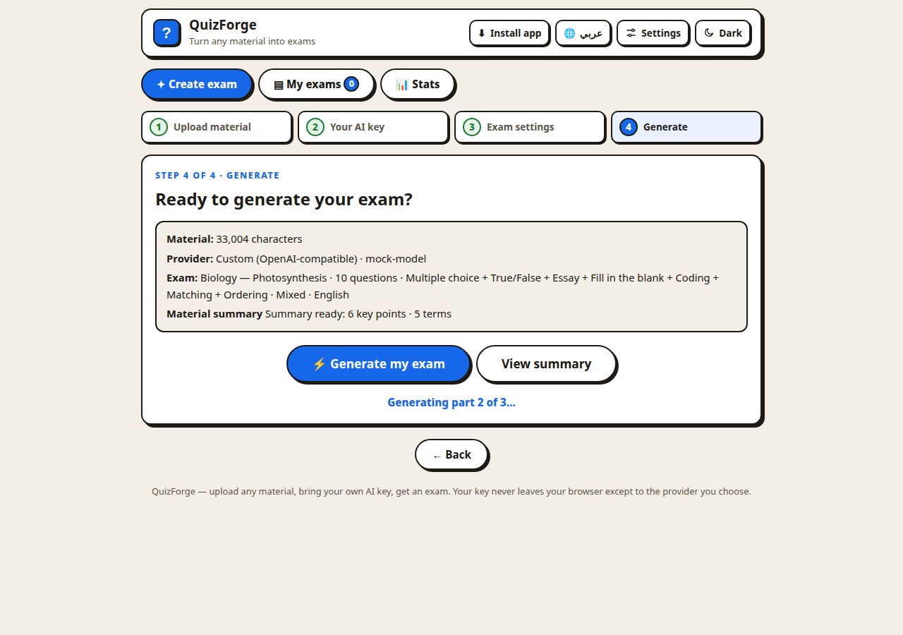 | 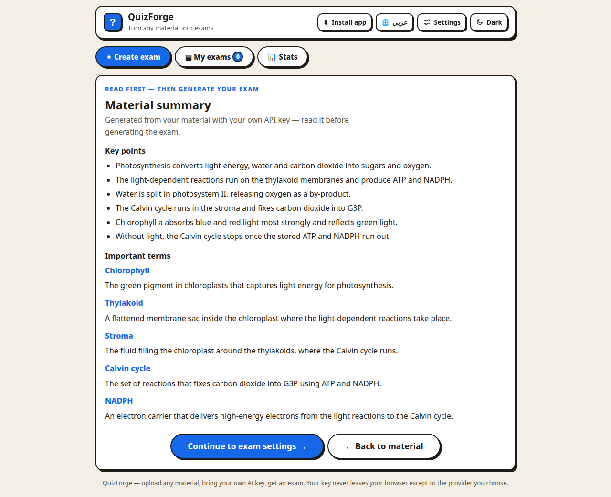 | 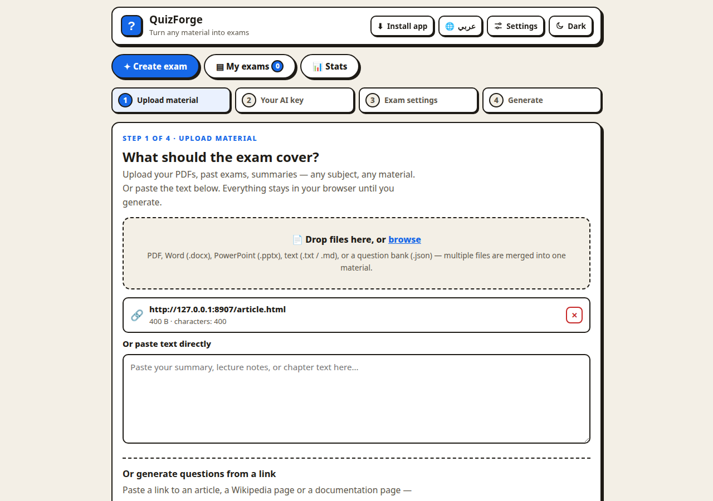 |  |

### Take the exam

| Start screen | A question | Essay + fill-in | Coding |
|---|---|---|---|
|  |  |  |  |

| Matching + ordering | True/False | Strict mode | Oral exam |
|---|---|---|---|
|  | 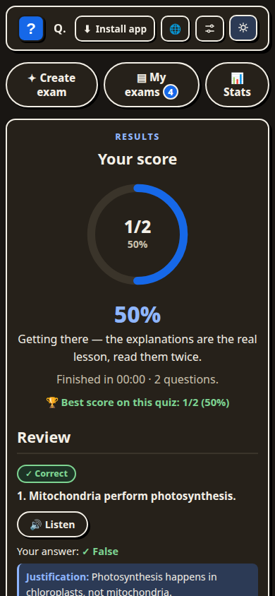 |  |  |

### Learn from it

| Results | Smart review | Stats | Flashcards |
|---|---|---|---|
|  |  |  | 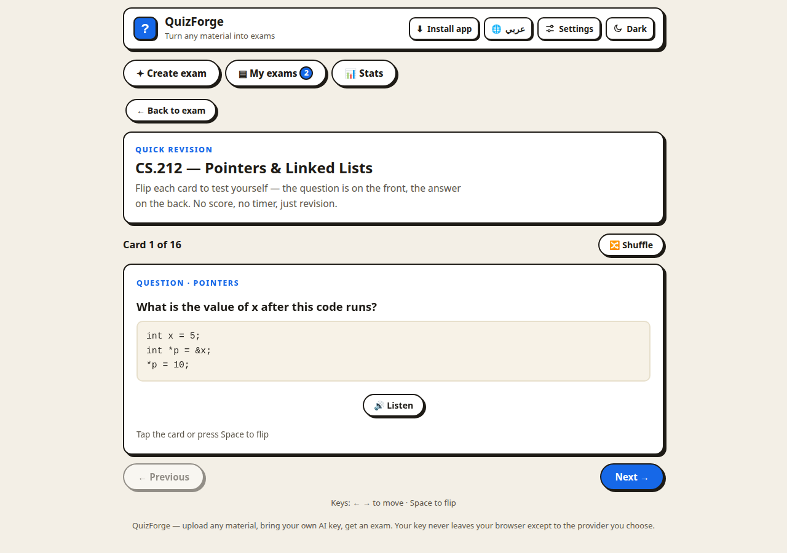 |

| Cheat sheet | Chat with the material | Past-exam analysis |
|---|---|---|
|  |  |  |

### Share, print & reuse

| Share via link | Translate the exam | Library backup |
|---|---|---|
| 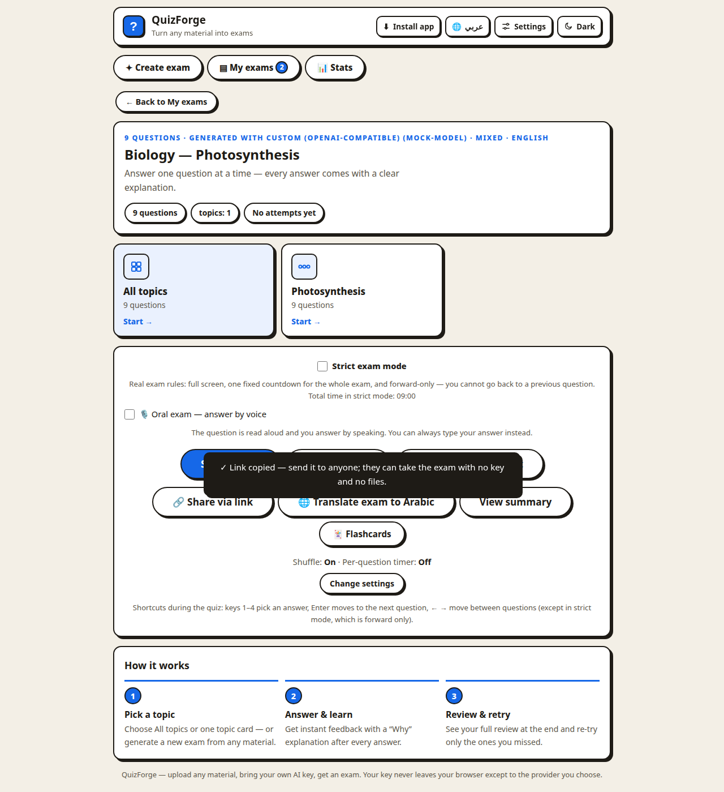 |  | 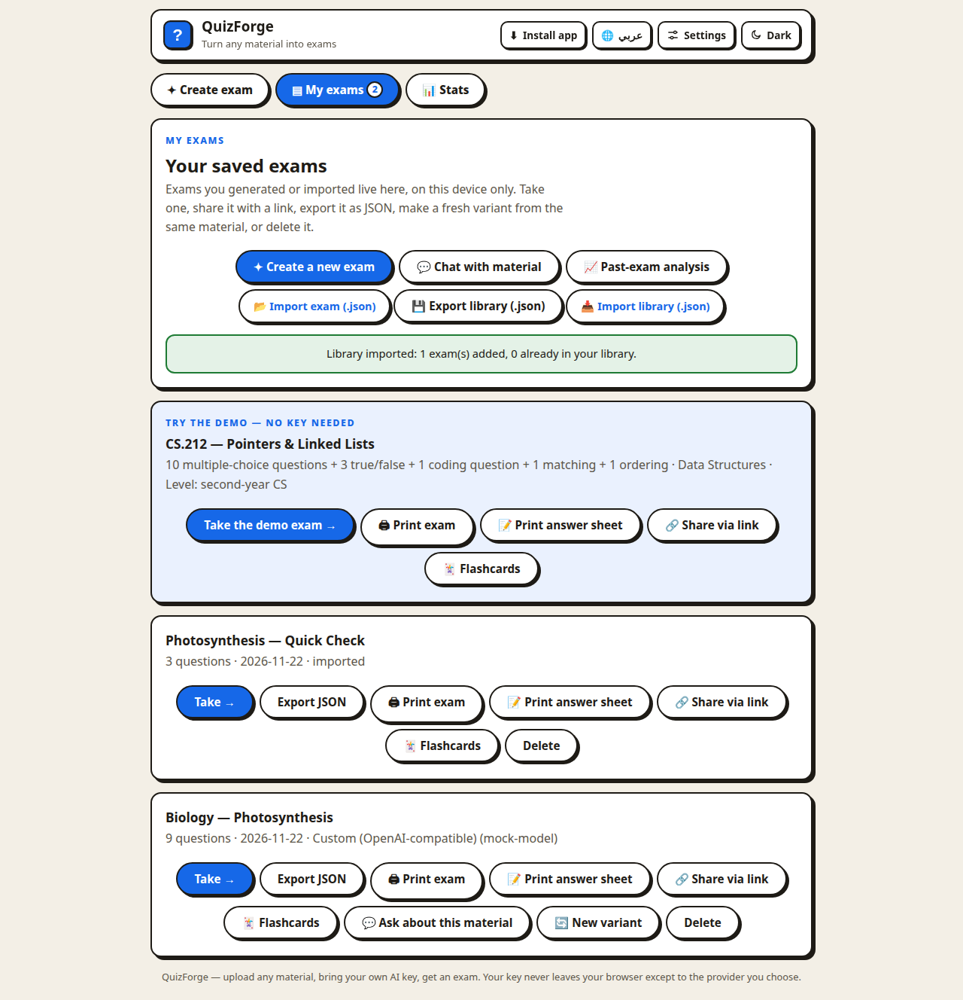 |

| My exams | Offline bar | Dark mode |
|---|---|---|
| 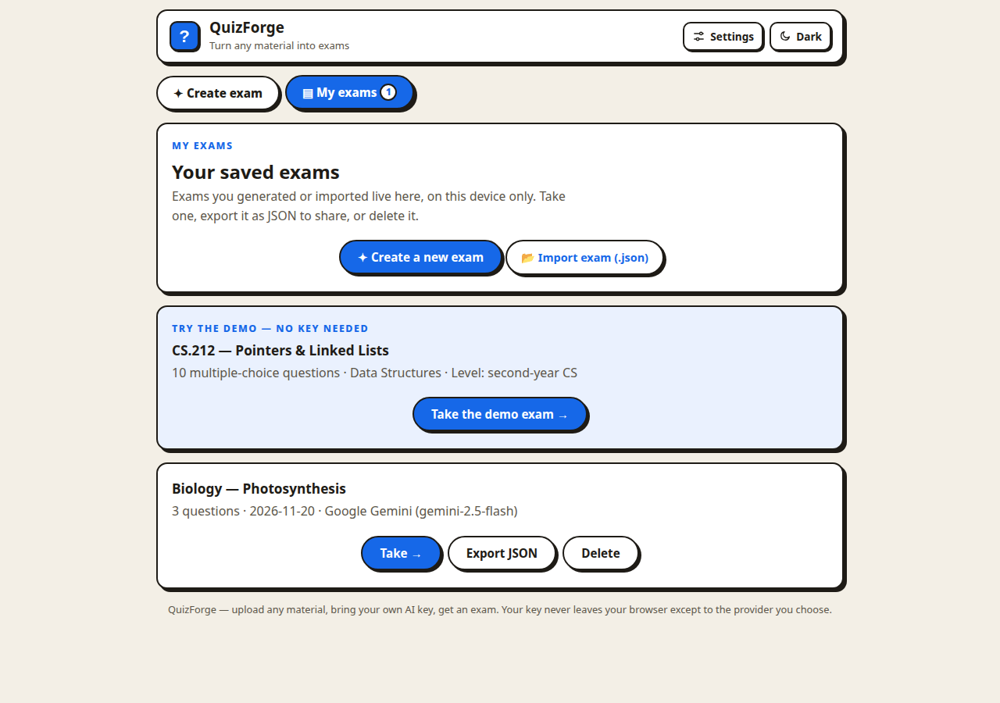 |  |  |

### The full interface in Arabic

| Start (Arabic) | Quiz (Arabic) | Results (Arabic) |
|---|---|---|
|  |  |  |

| True/False (Arabic) | Chat (Arabic) | Cheat sheet (Arabic) |
|---|---|---|
| 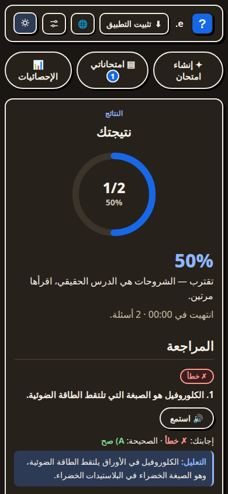 | 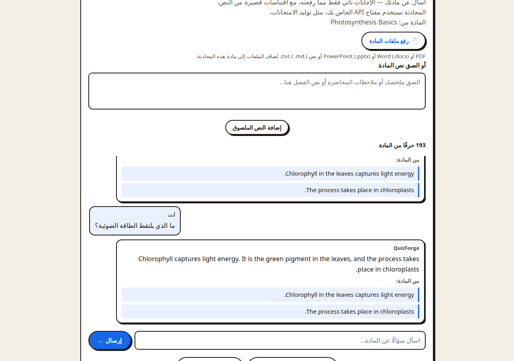 |  |

| Oral exam (Arabic) | Past exams (Arabic) | From a link (Arabic) |
|---|---|---|
|  |  | 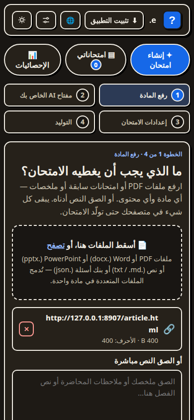 |

### On your phone (390px)

| Start | Upload | A question | Results |
|---|---|---|---|
| 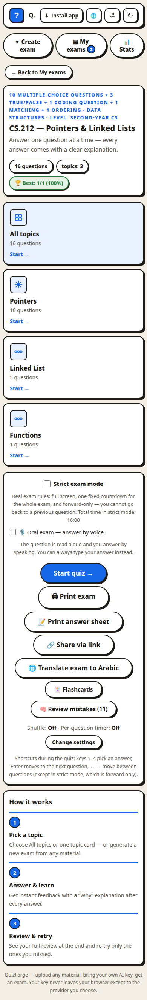 | 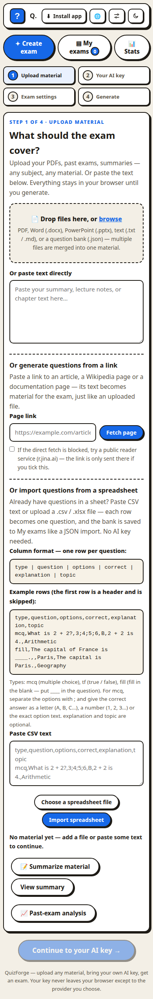 |  | 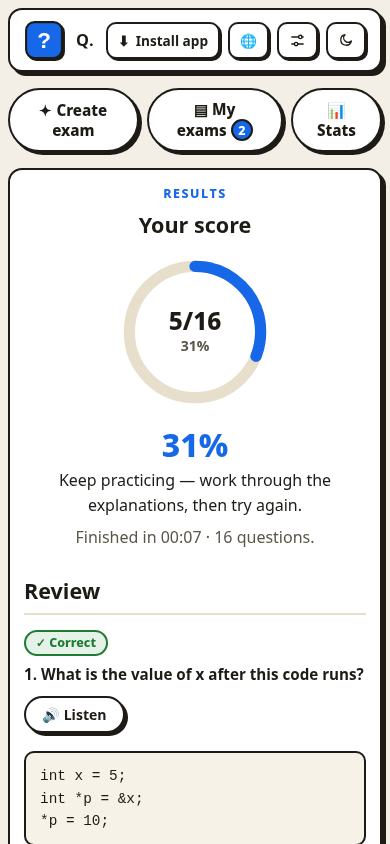 |

## Features

### Generate

- **Any material in.** PDF, Word (`.docx`), PowerPoint (`.pptx`), text (`.txt` / `.md`), a question bank (`.json`), pasted text — or a **link** to an article, Wikipedia page or docs page, fetched in the browser and turned into material (with an opt-in public reader service and a paste fallback when the site blocks direct fetching). Several files merge into one material, capped at 200,000 characters. Readers extract plain text only — no OCR, no images, no speaker notes — and say so plainly when a file has nothing readable.
- **Your key, your credits (BYOK).** Pick a provider, paste your API key, pick a model, press **Test connection**. The key is stored only on your device and only the last 4 characters are ever shown. Claude needs a CORS proxy (its API blocks direct browser calls); Gemini, OpenAI and any OpenAI-compatible endpoint work directly.
- **Exam settings that actually shape the exam.** Title, 5–50 questions, question types (multiple-choice, true/false, essay, fill-in, coding, matching, ordering), difficulty (Easy / Medium / Hard / Mixed), language (English / Arabic), focus notes ("focus on chapter 3, skip proofs"), and an optional per-question countdown.
- **Material summary.** One button asks your provider for the material's key points (up to 12) plus definitions of its important terms (up to 20), shown before you generate. The summary is saved with the exam and re-readable from its start screen — and it is dropped automatically if you change the material, so it can never describe the wrong text.
- **Past-exam analysis.** Add 2+ past exams (PDF, Word or text, each labelled with its year) and get a ranked list of topics by how often they repeat across years, most-repeated first. One tap then generates a new exam focused on the most-repeated topics (those in at least 2 exams, up to 8), with the past exams as its material.
- **Fresh exam variant.** A **New variant** button on any exam that still carries its material generates a genuinely different exam — same settings, different questions: the provider is told not to repeat the earlier questions and the result is deduped against them; if it still comes out identical, nothing is saved. Saved as "Title (variant 2)", then 3, 4…

### Take the exam

- **The quiz engine.** One question at a time, progress bar, shuffle of questions and options (on by default, key tracked through the shuffle), instant feedback with a "Why" explanation, a per-question countdown option, topic cards to drill one topic, your best score on the start screen, dark mode, and keyboard shortcuts (number keys pick an answer, Enter moves on).
- **Seven question types, one engine.** Multiple-choice (4 options), true/false with a **justification** shown in its own highlighted box right after answering, essay, fill-in-the-blank, coding, matching, ordering — all mixed freely in one exam, all counted in stats, review, print and flashcards.
- **Essay + fill-in, graded honestly.** Essays are graded by your provider against a short rubric the generator wrote (max score 5 by default, correct at 60%); with no key, or if grading fails, the rubric is shown instead — a grade is never invented. Fill-ins are checked locally in the browser against a list of accepted answers (case-insensitive), no API call needed.
- **Coding questions (JavaScript only).** A runnable editor prefilled with starter code, a **Run tests** button to check without submitting, and per-test pass/fail with input, expected and actual output. Code runs sandboxed in a Web Worker and is killed after 3 seconds, so an infinite loop reports a timeout instead of hanging the page. Any other language is rejected on import — the app never claims a language runs when it does not.
- **Matching + ordering.** Matching connects two columns (dropdowns over shuffled partners); ordering arranges steps with ↑ / ↓ buttons. Grading is by fraction ("2 of 3 pairs correct") and a question only counts as fully correct when every pair matches or the whole order is right — partial credit is never rounded up to a pass.
- **Strict exam mode.** An opt-in toggle on the start screen runs the exam under real exam rules: full screen, one fixed countdown for the whole exam (per-question seconds × question count, or 60s per question by default), forward-only navigation with no way back. At zero it auto-submits with whatever is answered; leaving full screen shows one warning and never auto-fails. Results note the exam was taken in strict mode.
- **Oral exam by voice.** A toggle on the start screen reads each question aloud and lets you answer by speaking (browser speech recognition, `ar-EG` / `en-US`). Spoken letters, numbers, ordinals ("the second one", "الخيار التاني") or the option text itself are matched locally against the displayed options — no key needed. Open answers go to your provider for grading (0–100 + feedback); with no key they are saved ungraded with a clear message, never a fake grade. Matching/ordering fall back to the written UI.
- **Read questions aloud (TTS).** A speaker button on every question, flashcard and results-review row reads it with the device's speech synthesis — on-device, no network, no key. Auto-read (off by default) and speed (Slow / Normal / Fast) live in Settings; the voice follows the exam's language. Code is never read aloud, and matching/ordering are read in display order so the answer is never given away.

### Learn from it

- **Smart review (spaced repetition).** Every question you miss joins a persistent review queue (per exam, saved on this device). A question leaves the queue only after **2 correct answers in a row** — a wrong answer resets the streak to zero, and the streak is shown on every question. Reviewing never changes your saved exams or your best score.
- **Cheat sheet from your mistakes.** On the results screen, one tap builds a one-page sheet covering exactly one missed concept per entry: the correct fact and your mistake corrected. With a key it is condensed by your provider; without one it is built verbatim from the stored explanations and says so. It is stored with the attempt, so it reopens from results or Stats without another provider call, and it prints on exactly one page.
- **Stats dashboard.** Every completed attempt is recorded (exam, date, score, per-question topic and time spent), keeping the newest 50. The dashboard shows totals, per-topic accuracy bars with strongest / needs-work topics called out, and the last 8 attempts. A **Clear history** button wipes it.
- **Flashcards.** A deck built from any exam's own questions — no provider calls. Question on the front, answer + explanation on the back (rubric for essays, accepted answers for fill-ins). Flip by tap, Space or Enter; arrow keys move (they follow the page direction in RTL); a Shuffle toggle reshuffles the deck.
- **Chat with the material.** Ask questions about an exam's source material and get answers grounded in it — only the most relevant chunk(s) are sent, the provider is told to answer only from the material and to say so when it is not there, and answers come with short verbatim quotes. Follow-ups keep the last 3 exchanges as context; history (last 30 messages per chat) survives reloads. A fresh chat in the library header takes its own uploads or pasted text.

### Share, print & reuse

- **Share via link.** The whole exam is packed into the URL hash (`#exam=…`, deflate-compressed), so the link works from any static host with no server — anyone who opens it gets the exam straight into the quiz, no files, no key. Links over ~8 KB are refused with a clear warning (use Export JSON instead), and a damaged link shows a friendly error, not a blank page.
- **Print / PDF export.** Print the whole exam — all questions with options, then an answer key with the correct answer and explanation on the last page — via the browser's print dialog, so it also saves as PDF. Always clean black-on-white, even in dark mode, questions kept from splitting across pages, RTL-safe.
- **Printable answer sheet.** A paper bubble sheet for a real exam room: title, blank Name / Date / Class fields, one bubble (○, lettered A–F) per option for multiple-choice and true/false, lined write-in space for essay, fill-in, coding, matching and ordering.
- **Exam translation (EN ↔ AR).** One tap translates a whole exam between English and Arabic; the original is kept untouched and restored exactly by tapping again. Code, starter code, test values, fill-in answers, topics and the title are never translated, and the answer key never moves, so grading is identical in either language. If any batch fails, nothing is applied.
- **Sheets / Excel import.** Paste CSV or upload `.csv` / `.xlsx` (one documented column format: `type | question | options | correct | explanation | topic`); each row becomes one question — `mcq`, `tf` or `fill`. Bad rows are listed by row number with a plain reason, and a file with zero valid rows imports nothing.
- **Library backup.** Export the whole library as one JSON file (`quizforge-library-YYYY-MM-DD.json`) and import it back anywhere: exams already present are skipped, the rest are added, and a corrupt or non-backup file changes nothing. Backups carry the material and settings too, so a restored exam can still make a variant and chat about its material.
- **My exams (library).** Every generated or imported exam lives here, on this device only, with Take / Export JSON / Delete — plus the demo bank card ("Try the demo — no key needed") and entry points to chat, past-exam analysis, flashcards and review.
- **Arabic UI.** The header toggle (🌐 عربي / English) flips the whole interface to a right-to-left layout — header, wizard, library, quiz, results — and remembers your choice. You can switch mid-quiz; the attempt and the countdown keep running. The exam content itself is separate: translate it with the button above, or generate it in Arabic from the start. (600+ interface strings, same coverage in both languages.)
- **Offline mode (PWA).** A service worker caches the whole app shell (page, scripts, styles, demo bank, manifest, icon) under a versioned cache (`quizforge-v4` in `sw.js`), so once opened it loads with no connection at all. An **Install app** button appears when the browser offers it. Everything local — demo bank, saved exams, quiz, review, stats, flashcards, strict mode, print, share-link decode — works offline, and a small bar under the header says when you are offline. Network features (generation, summary, translation, essay grading, first-time reader loads) refuse offline with a clear message instead of failing silently.

## How it works

1. **Upload material** — PDF, Word, PowerPoint, text, a JSON bank, pasted text, or a link. Multiple files merge into one material.
2. **Your AI key** — pick a provider, paste your key, pick a model, press **Test connection**. You spend your own credits; QuizForge has no server and no account.
3. **Exam settings** — title, 5–50 questions, question types, difficulty, language, focus notes, optional per-question countdown.
4. **Generate** — the material is split into ~12,000-character chunks, questions are generated per chunk with a progress indicator ("Generating part 2 of 3…"), then merged, de-duplicated and shuffled. The exam is saved to **My exams** and you can take it right away.

## Providers

| Provider | Default model | Notes |
|---|---|---|
| Google Gemini | `gemini-3.5-flash-lite` | Direct call, JSON mode. |
| OpenAI (ChatGPT) | `gpt-4o-mini` | Direct call, Chat Completions, `response_format: json_object`. |
| Anthropic Claude | `claude-sonnet-5-5` | **Needs a CORS proxy** — see below. |
| Custom (OpenAI-compatible) | `gpt-4o-mini` | Any base URL + model, same shape as OpenAI. |

Model IDs change fast — every model field is editable, so if a provider retires a model you can type the new ID in the same field. Defaults were verified 2026-11-20 against the providers' own docs: Google retires `gemini-2.5-flash` on 2026-12-01 and serves it only to projects that already used it, so a brand-new key cannot call it; `gpt-4o-mini` still works but OpenAI retires it 2027-01-14; `claude-sonnet-4-5` is retired by Anthropic on 2026-11-30, so the Claude default is its named replacement `claude-sonnet-5-5` — do not use `claude-sonnet-4-5` after that date.

### Claude and CORS

Claude's API blocks direct calls from a browser page, so QuizForge cannot call it without a CORS proxy. Add your proxy URL in Step 2 — the proxy must forward the request to `https://api.anthropic.com` and pass the `x-api-key` header through. Without a proxy, Claude shows a plain message explaining this before any call is made. Gemini, OpenAI and Custom endpoints work directly.

## Privacy

**Your key never leaves your browser except to the provider you choose.** It is stored only on your own machine (localStorage), never logged, and never shown in full — only the last 4 characters, e.g. `••••••••1234`. Generated exams are also stored only locally. There is no account, no analytics, no server receiving your material or your key.

## Question-bank format

Generated and imported exams use the same JSON format:

```json
{
  "title": "My Quiz",
  "subtitle": "A short line shown under the title",
  "questions": [
    {
      "question": "What is 2 + 2?",
      "code": "optional code snippet shown above the options",
      "topic": "Arithmetic",
      "difficulty": "Easy",
      "options": ["3", "4", "5", "6"],
      "answer": 1,
      "explanation": "2 + 2 is 4. A short reason is more useful than just the letter."
    }
  ]
}
```

Rules: `options` needs at least 2 entries (4 for multiple choice, 2 — `"True"` / `"False"` — for True/False), and `answer` is the **0-based** index of the correct option (so `1` means the second option). `code`, `topic`, `difficulty` and `explanation` are optional — but `explanation` is the part that actually teaches, and `topic` powers the topic cards. Questions with no `"type"` are treated as multiple choice (or True/False when they have exactly 2 options), so older banks keep working unchanged.

Two more shapes use the same array — set `"type"` on the question:

```json
{
  "question": "Explain in two or three sentences why photosynthesis matters for life on Earth.",
  "type": "essay",
  "rubric": "Mentions that photosynthesis produces oxygen and glucose; links both to life on Earth.",
  "maxScore": 5,
  "topic": "Photosynthesis",
  "difficulty": "Medium",
  "explanation": "Photosynthesis is the base of nearly every food chain and the source of the oxygen we breathe."
},
{
  "question": "Photosynthesis takes place in the ____ of the plant cell.",
  "type": "fill",
  "answers": ["chloroplast", "chloroplasts"],
  "topic": "Photosynthesis",
  "difficulty": "Easy",
  "explanation": "Chloroplasts hold the chlorophyll that captures light energy."
}
```

Rules: an essay needs a `"rubric"` (short grading text) and takes an optional `"maxScore"` (1–100, default 5); it is graded by the AI and counts as correct at 60% of its max. A fill-in-the-blank needs an `"answers"` array with at least one accepted answer and exactly one blank written as `____` in the question text; it is checked locally, case-insensitively. Neither shape has `"options"` or `"answer"`.

A coding question is the same array with `"type": "coding"` — **JavaScript only**:

```json
{
  "question": "Write a function sum(a, b) that returns the sum of its two numbers.",
  "type": "coding",
  "language": "JavaScript",
  "starterCode": "function sum(a, b) {\n  // write your code here\n}",
  "tests": [
    { "input": "sum(2, 3)", "expected": "5" },
    { "input": "sum(-1, 1)", "expected": "0" }
  ],
  "topic": "Functions",
  "difficulty": "Easy",
  "explanation": "The function must return a + b for any two numbers."
}
```

Rules: `"language"` must be `"JavaScript"` (any other language is rejected — it cannot run in the browser). `"starterCode"` is the code the student starts from, and `"tests"` is an array of 1 or more tests, each with `"input"` — a JavaScript expression that calls the student's function — and `"expected"` — the exact result as a string. The student's code runs in a Web Worker against those tests (3-second timeout); a question counts as correct only when every test passes.

A matching question has `"type": "matching"` and a `"pairs"` array of 2 or more objects, each with `"left"` and `"right"` (the right value is the correct partner for that left value); every left and right value must be unique. An ordering question has `"type": "ordering"` and an `"items"` array of 2 or more unique strings in the **correct** order. Neither shape has `"options"` or `"answer"`.

```json
{
  "question": "Match each pointer term with its correct meaning.",
  "type": "matching",
  "pairs": [
    { "left": "int *p", "right": "A pointer that holds the address of an int" },
    { "left": "&x", "right": "The address of x" },
    { "left": "*p", "right": "The value stored at the address p points to" }
  ],
  "topic": "Pointers",
  "difficulty": "Easy",
  "explanation": "The * in a declaration makes p a pointer, & takes an address, and * follows the pointer to its value."
}
```

## Run it / Deploy

**Run locally.** Browsers block `fetch()` from `file://`, so serve the folder with a tiny local server (from inside this folder):

```bash
python3 -m http.server 8000
```

Then open <http://localhost:8000> in your browser. (`npx serve .` or VS Code's Live Server work too.)

**Or take the demo.** In **My exams**, press **Take the demo exam** — 16 verified questions on C pointers and linked lists, no key needed.

**Deploy free on GitHub Pages:** push this folder to a public repo → **Settings → Pages** → **Deploy from a branch**, branch `main`, folder `/ (root)`. Live at `https://<username>.github.io/<repo-name>/` within a minute or two. It also works as a static site on Netlify Drop, Vercel, or Cloudflare Pages — just upload the folder. Note: PDF reading loads pdf.js from cdnjs the first time a PDF is added, Word/PowerPoint reading loads JSZip from cdnjs the first time a `.docx` or `.pptx` file is added, and spreadsheet reading loads SheetJS the first time a `.xlsx` file is added, so those steps need internet; the demo bank and everything else work fully offline once loaded.

## Project structure

```
index.html            — the app shell (header, nav, wizard mount point)
app.js                — everything: wizard, providers, generation, library, quiz engine
i18n.js               — English + Arabic strings (600+ keys, same coverage in both)
style.css             — all styling: beige identity, dark mode, responsive layout
questions.json        — the built-in demo bank (16 C pointers / linked-list questions)
sw.js                 — service worker, versioned cache (quizforge-v4)
docs/screenshots/     — real screenshots of the app (desktop + mobile)
CHANGELOG.md          — what changed in each update
LICENSE               — MIT
```

## Contributing

Pull requests are welcome. If you add questions, please keep the same bar as the sample bank: every answer checked (run the code when the question has code), four options for MCQ, a `topic`, and a real explanation — not just the correct letter. See [CHANGELOG.md](CHANGELOG.md) for what changed in each update. All automated checks run against a local mock provider, never a live API or a real key.

## License

MIT — see [LICENSE](LICENSE).

---

<div dir="rtl" lang="ar">

## العربية

**QuizForge** يحوّل أي مادة دراسية إلى امتحان — أي مادة، وأي شخص. ارفع ملفات PDF أو امتحانات سابقة أو شرائح أو ملخصات، ضع **مفتاح الـ API الخاص بك**، حدّد مواصفات الامتحان، واحصل على اختبار جاهز في ثوانٍ. لا حساب، لا خادم، لا خطوة بناء: موقع ثابت يعمل بالكامل في متصفحك (ومجاني على GitHub Pages). بدأ كتطبيق صغير اسمه Practice Quiz Builder ببنك أسئلة موثّق عن المؤشرات والقوائم المتصلة في C — والبنك ما زال موجودًا كعرض تجريبي مدمج، وأصبح الآن **16 سؤالًا** (10 اختيار من متعدد، 3 صح/خطأ، 1 مطابقة، 1 ترتيب، 1 برمجة)، يعمل بدون مفتاح إطلاقًا.

### المميزات

**التوليد**

- **أي مادة تدخل.** PDF وWord (`.docx`) وPowerPoint (`.pptx`) ونص (`.txt` / `.md`) وبنك أسئلة (`.json`) ونص ملصوق — أو **رابط** لمقال أو صفحة ويكيبيديا أو توثيق، يُجلب من المتصفح ويتحول إلى مادة (مع خدمة قراءة عامة اختيارية وبديل اللصق عند حظر الموقع للجلب المباشر). ملفات متعددة تندمج في مادة واحدة بحد أقصى 200,000 حرف. القارئات تستخرج النص العادي فقط — لا OCR ولا صور ولا ملاحظات متحدث — وتقول ذلك بوضوح عندما لا يوجد نص مقروء.
- **مفتاحك أنت، ورصيدك أنت (BYOK).** اختر المزوّد، الصق مفتاح الـ API، اختر النموذج، واضغط **اختبار الاتصال**. المفتاح يُحفظ على جهازك فقط ولا يظهر منه سوى آخر 4 أحرف. Claude يحتاج وكيل CORS (واجهته تمنع النداء المباشر من المتصفح)؛ أما Gemini وOpenAI وأي نقطة متوافقة مع OpenAI فتعمل مباشرة.
- **إعدادات امتحان تصنع فرقًا حقيقيًا.** العنوان، من 5 إلى 50 سؤالًا، أنواع الأسئلة (اختيار من متعدد، صح/خطأ، مقالي، أكمل، برمجة، مطابقة، ترتيب)، الصعوبة (سهل / متوسط / صعب / مختلط)، اللغة (إنجليزي / عربي)، ملاحظات تركيز ("ركّز على الفصل الثالث، وتخطَّ البراهين")، وعدّاد تنازلي اختياري لكل سؤال.
- **تلخيص المادة.** زر واحد يطلب من مزوّدك أهم نقاط المادة (حتى 12 نقطة) وتعريفات مصطلحاتها المهمة (حتى 20 تعريفًا)، وتظهر قبل توليد الامتحان. الملخص يُحفظ مع الامتحان ويُعاد قراءته من شاشة البداية — ويُحذف تلقائيًا إذا غيّرت المادة، فلا يصف أبدًا نصًا غير نصه.
- **تحليل امتحانات السنوات السابقة.** أضف امتحانين أو أكثر (PDF أو Word أو نص، مع سنة كل امتحان) لتحصل على قائمة مرتبة بالمواضيع حسب تكرارها عبر السنوات، الأكثر تكرارًا أولًا. وبضغطة واحدة يُولَّد امتحان جديد مركّز على أكثر المواضيع تكرارًا (الموجودة في امتحانين على الأقل، حتى 8 مواضيع)، وتكون الامتحانات السابقة هي مادته.
- **نسخة جديدة من الامتحان.** زر **نسخة جديدة** على أي امتحان ما زال يحمل مادته يولّد امتحانًا مختلفًا فعلًا — نفس الإعدادات، أسئلة مختلفة: يُطلب من المزوّد عدم تكرار أسئلة النسخة السابقة، وتُزال التكرارات بعدها أيضًا؛ وإن خرجت مطابقة تمامًا لا يُحفظ شيء. تُحفظ باسم "العنوان (نسخة 2)" ثم 3، 4…

**أداء الامتحان**

- **محرك الاختبار.** سؤال واحد في كل مرة، شريط تقدم، خلط للأسئلة والاختيارات (مفعّل افتراضيًا، والمفتاح يُتتبَّع عبر الخلط)، تصحيح فوري مع شرح "لماذا"، عدّاد تنازلي اختياري لكل سؤال، بطاقات مواضيع للتدريب على موضوع واحد، أفضل نتيجة على شاشة البداية، الوضع الداكن، واختصارات لوحة المفاتيح (أرقام تختار الإجابة، Enter للانتقال).
- **سبعة أنواع أسئلة في محرك واحد.** اختيار من متعدد (4 اختيارات)، صح/خطأ مع **تعليل** يظهر في صندوق مميز فور الإجابة، مقالي، أكمل، برمجة، مطابقة، ترتيب — تختلط بحرية في امتحان واحد، وتُحسب كلها في الإحصائيات والمراجعة والطباعة والفلاش كاردز.
- **مقالي وأكمل بتصحيح صادق.** المقال يُصحَّح عبر مزوّدك وفق معيار قصير كتبه المولّد (الدرجة القصوى 5 افتراضيًا، والنجاح عند 60%)؛ وبدون مفتاح، أو عند فشل التصحيح، يظهر المعيار بدل الدرجة — لا تُخترع درجة أبدًا. الأكمل يُفحص محليًا في المتصفح مقابل قائمة إجابات مقبولة (غير حساس لحالة الأحرف)، بدون أي نداء API.
- **أسئلة برمجة (JavaScript فقط).** محرر قابل للتشغيل مملوء بالكود الابتدائي، وزر **تشغيل الاختبارات** للتحقق دون تسليم، ونتيجة نجاح/فشل لكل اختبار مع المدخل والمتوقع والفعلي. الكود يعمل في بيئة معزولة (Web Worker) ويُقتل بعد 3 ثوانٍ، فالحلقة اللانهائية تُبلَّغ كمهلة بدل تعليق الصفحة. أي لغة أخرى تُرفض عند الاستيراد — التطبيق لا يدّعي أبدًا أن لغة تعمل وهي لا تعمل.
- **مطابقة وترتيب.** المطابقة تربط عمودين (قوائم منسدلة فوق شركاء مخلوطين)؛ والترتيب يرتّب الخطوات بأزرار ↑ / ↓. التصحيح بالنسبة ("2 من 3 أزواج صحيحة")، ولا يُحسب السؤال صحيحًا كاملًا إلا عند مطابقة كل الأزواج أو صحة الترتيب كله — لا يُقرَّب النصف إلى نجاح.
- **وضع الامتحان الصارم.** مفتاح اختياري على شاشة البداية يشغّل الامتحان بقواعد امتحان حقيقي: ملء الشاشة، عدّاد تنازلي ثابت للامتحان كله (ثواني كل سؤال × عدد الأسئلة، أو 60 ثانية للسؤال افتراضيًا)، وتنقّل للأمام فقط بلا عودة. عند الصفر يُسلَّم تلقائيًا بما أُجيب؛ والخروج من ملء الشاشة يظهر تحذيرًا واحدًا ولا يُفشل الامتحان أبدًا. النتائج تذكر أن الامتحان أُخذ في الوضع الصارم.
- **امتحان شفوي بالصوت.** مفتاح على شاشة البداية يقرأ كل سؤال بصوت عالٍ ويتيح الإجابة بالكلام (تعرّف الكلام في المتصفح، `ar-EG` / `en-US`). الحروف المنطوقة أو الأرقام أو الترتيب ("الخيار التاني") أو نص الاختيار نفسه تُطابَق محليًا مع الاختيارات المعروضة — بدون مفتاح. الإجابات المفتوحة تُرسل لمزوّدك للتقييم (0–100 مع تعليق)؛ وبدون مفتاح تُحفظ بلا تقييم مع رسالة واضحة، لا درجة مزيفة. المطابقة والترتيب يعودان للواجهة المكتوبة.
- **قراءة الأسئلة بصوت عالٍ (TTS).** زر سماعة على كل سؤال وفلاش كارد وصف في مراجعة النتائج يقرأه بنطق الجهاز — على الجهاز، بلا إنترنت، بلا مفتاح. القراءة التلقائية (متوقفة افتراضيًا) والسرعة (بطيء / عادي / سريع) في الإعدادات؛ والصوت يتبع لغة الامتحان. الكود لا يُقرأ أبدًا، والمطابقة والترتيب تُقرآن بترتيب العرض حتى لا تُكشف الإجابة.

**التعلّم من الامتحان**

- **مراجعة ذكية للأخطاء (تكرار متباعد).** كل سؤال تخطئ فيه ينضم إلى قائمة مراجعة دائمة (لكل امتحان، محفوظة على جهازك). لا يغادر السؤال القائمة إلا بعد **إجابتين صحيحتين متتاليتين** — والخطأ يصفّر العدّاد، والعدّاد يظهر على كل سؤال. المراجعة لا تغيّر امتحاناتك المحفوظة ولا أفضل نتيجة لك.
- **ورقة غش من أخطائك.** على شاشة النتائج، ضغطة واحدة تبني ورقة من صفحة واحدة: كل خطأ مفهوم واحد — الحقيقة الصحيحة وخطؤك مصحّحًا. بمفتاح يلخّصها مزوّدك؛ وبدونه تُبنى حرفيًا من الشروحات المحفوظة وتقول ذلك. تُحفظ مع المحاولة فتُعاد فتحها من النتائج أو الإحصائيات دون نداء جديد، وتُطبع في صفحة واحدة بالضبط.
- **لوحة الإحصائيات.** كل محاولة مكتملة تُسجَّل (الامتحان، التاريخ، الدرجة، موضوع كل سؤال والوقت المستغرق فيه)، مع الاحتفاظ بأحدث 50 محاولة. اللوحة تعرض الإجماليات، وأشرطة دقة لكل موضوع مع أقوى المواضيع وتلك التي تحتاج عملًا، وآخر 8 محاولات. زر **مسح السجل** يمسحها كلها.
- **فلاش كاردز.** رزمة من أسئلة أي امتحان — بلا أي نداءات لمزوّد. السؤال على الوجه، والإجابة والشرح على الظهر (المعيار للمقالي، والإجابات المقبولة للأكمل). اقلب بالنقر أو المسافة أو Enter؛ وأسهم لوحة المفاتيح تتنقل (وتتبع اتجاه الصفحة في RTL)؛ ومفتاح خلط يعيد ترتيب الرزمة.
- **محادثة مع المادة.** اسأل عن المادة المصدر لأي امتحان واحصل على إجابات مؤسَّسة عليها — تُرسل فقط المقاطع الأكثر صلة، ويُطلب من المزوّد الإجابة من المادة وحدها وأن يقول ذلك بوضوح عندما لا تكون الإجابة فيها، مع اقتباسات حرفية قصيرة. المتابعات تحتفظ بآخر 3 تبادلات كسياق؛ والسجل (آخر 30 رسالة لكل محادثة) يبقى بعد إعادة التحميل. محادثة جديدة من رأس المكتبة تقبل رفع ملفات أو لصق نص.

**المشاركة والطباعة وإعادة الاستخدام**

- **مشاركة برابط.** الامتحان كله يُحزَم في رابط URL نفسه (`#exam=…` مضغوطًا)، فيعمل من أي استضافة ثابتة بلا خادم — من يفتحه يدخل الامتحان مباشرة، بلا ملفات، بلا مفتاح. الروابط فوق ~8 كيلوبايت تُرفض برسالة واضحة (استخدم تصدير JSON بدلًا منها)، والرابط التالف يظهر خطأً ودودًا لا صفحة فارغة.
- **طباعة / تصدير PDF.** اطبع الامتحان كاملًا — كل الأسئلة باختياراتها، ثم مفتاح إجابة بالصحيح والشرح في الصفحة الأخيرة — عبر حوار الطباعة في المتصفح، فيُحفظ كـ PDF أيضًا. أسود على أبيض دائمًا حتى في الوضع الداكن، والأسئلة لا تنقسم عبر الصفحات، ويدعم RTL.
- **ورقة إجابة للطباعة.** ورقة فقاعات ورقية لقاعة امتحان حقيقية: العنوان، وحقول فارغة للاسم والتاريخ والفصل، وفقاعة (○، بحروف A–F) لكل اختيار في أسئلة الاختيار من متعدد وصح/خطأ، ومساحة كتابة مسطّرة للمقالي والأكمل والبرمجة والمطابقة والترتيب.
- **ترجمة الامتحان (إنجليزي ⇄ عربي).** ضغطة واحدة تترجم الامتحان كله بين الإنجليزية والعربية؛ والنسخة الأصلية تُحفظ كما هي وتُستعاد بالضبط بضغطة أخرى. الكود والكود الابتدائي وقيم الاختبارات وإجابات الأكمل والمواضيع والعنوان لا تُترجم أبدًا، ومفتاح الإجابة لا يتحرك، فالتصحيح متطابق بأي لغة. وإن فشلت أي دفعة، لا يُطبَّق شيء.
- **استيراد من Sheets / Excel.** الصق CSV أو ارفع `.csv` / `.xlsx` (تنسيق أعمدة موثّق واحد: `type | question | options | correct | explanation | topic`)؛ كل صف يصبح سؤالًا — `mcq` أو `tf` أو `fill`. الصفوف السيئة تُدرَج برقم الصف مع سبب واضح، والملف بلا صفوف صالحة لا يستورد شيئًا.
- **نسخة احتياطية للمكتبة.** صدّر المكتبة كلها كملف JSON واحد (`quizforge-library-YYYY-MM-DD.json`) واستعده في أي مكان: الموجود أصلًا يُتخطَّى، والباقي يُضاف، والملف التالف أو غير الاحتياطي لا يغيّر شيئًا. النسخ تحمل المادة والإعدادات أيضًا، فيبقى الامتحان المستعاد قادرًا على توليد نسخة جديدة والمحادثة عن مادته.
- **امتحاناتي (المكتبة).** كل امتحان مولَّد أو مستورد يعيش هنا، على جهازك فقط، مع أخذ / تصدير JSON / حذف — إضافة إلى بطاقة العرض التجريبي ("جرّب العرض التجريبي — بلا مفتاح") ومداخل للمحادثة وتحليل الامتحانات السابقة والفلاش كاردز والمراجعة.
- **واجهة عربية كاملة.** مفتاح الرأس (🌐 عربي / English) يقلب الواجهة كلها إلى تخطيط من اليمين لليسار — الرأس، والمعالج، والمكتبة، والاختبار، والنتائج — ويتذكر اختيارك. يمكنك التبديل في منتصف الامتحان؛ فالمحاولة والعدّاد يستمران. ومحتوى الامتحان نفسه منفصل: ترجمه بالزر أعلاه، أو ولّده بالعربية من البداية. (أكثر من 600 نص واجهة، بنفس التغطية في اللغتين.)
- **وضع دون اتصال (PWA).** عامل خدمة يخبّئ هيكل التطبيق كله (الصفحة، والسكريبتات، والأنماط، والبنك التجريبي، والبيان، والأيقونة) في ذاكرة مؤقتة مُصدَّرة (`quizforge-v4` في `sw.js`)، فبمجرد فتحه مرة يعمل بلا اتصال إطلاقًا. زر **تثبيت التطبيق** يظهر عندما يعرضه المتصفح. كل شيء محلي — البنك التجريبي، والامتحانات المحفوظة، والاختبار، والمراجعة، والإحصائيات، والفلاش كاردز، والوضع الصارم، والطباعة، وفتح رابط مشاركة — يعمل دون اتصال، وشريط صغير تحت الرأس يقول متى تكون دون اتصال. أما مزايا الشبكة (التوليد، والتلخيص، والترجمة، وتصحيح المقال، وتحميل القارئات أول مرة) فترفض دون اتصال برسالة واضحة بدل الفشل الصامت.

### كيف يعمل

1. **ارفع المادة** — PDF أو Word أو PowerPoint أو نص أو بنك JSON أو نص ملصوق أو رابط. ملفات متعددة تندمج في مادة واحدة.
2. **مفتاح الـ AI الخاص بك** — اختر المزوّد، الصق مفتاحك، اختر النموذج، واضغط **اختبار الاتصال**. تنفق من رصيدك أنت؛ فلا خادم ولا حساب في QuizForge.
3. **إعدادات الامتحان** — العنوان، من 5 إلى 50 سؤالًا، أنواع الأسئلة، الصعوبة، اللغة، ملاحظات التركيز، عدّاد تنازلي اختياري لكل سؤال.
4. **توليد** — تُقسَّم المادة إلى مقاطع من نحو 12,000 حرف، وتُولَّد الأسئلة لكل مقطع مع مؤشر تقدم ("جارٍ توليد الجزء 2 من 3…")، ثم تُدمج وتُزال التكرارات وتُخلط. يُحفظ الامتحان في **امتحاناتي** ويمكنك أخذه فورًا.

### المزوّدون

| المزوّد | النموذج الافتراضي | ملاحظات |
|---|---|---|
| Google Gemini | `gemini-3.5-flash-lite` | نداء مباشر، وضع JSON. |
| OpenAI (ChatGPT) | `gpt-4o-mini` | نداء مباشر، Chat Completions مع `response_format: json_object`. |
| Anthropic Claude | `claude-sonnet-5-5` | **يحتاج وكيل CORS** — انظر أدناه. |
| مخصّص (متوافق مع OpenAI) | `gpt-4o-mini` | أي رابط أساسي ونموذج، بنفس شكل OpenAI. |

معرّفات النماذج تتغير بسرعة — كل حقل نموذج قابل للتحرير، فإن تقاعد نموذج اكتب المعرّف الجديد في الحقل نفسه. الافتراضيات تحقّق منها في 2026-11-20 مقابل وثائق المزوّدين أنفسهم: Google تُقاعد `gemini-2.5-flash` في 2026-12-01 وتخدمه فقط للمشاريع التي استخدمته من قبل، فلا يستطيع مفتاح جديد نداءه؛ و`gpt-4o-mini` ما زال يعمل لكن OpenAI تُقاعده في 2027-01-14؛ و`claude-sonnet-4-5` تقاعدته Anthropic في 2026-11-30، فالافتراضي لـ Claude هو بديله المسمّى `claude-sonnet-5-5` — لا تستخدم `claude-sonnet-4-5` بعد ذلك التاريخ.

#### Claude وCORS

واجهة Claude تمنع النداءات المباشرة من صفحة متصفح، فلا يستطيع QuizForge نداءها بدون وكيل CORS. أضف رابط وكيلك في الخطوة 2 — يجب أن يمرّر الوكيل الطلب إلى `https://api.anthropic.com` ويمرّر رأس `x-api-key`. وبدون وكيل، يظهر لـ Claude رسالة واضحة تشرح ذلك قبل أي نداء. أما Gemini وOpenAI والنقاط المخصصة فتعمل مباشرة.

### الخصوصية

**مفتاحك لا يغادر متصفحك إلا إلى المزوّد الذي تختاره.** يُحفظ على جهازك فقط (localStorage)، ولا يُسجَّل أبدًا، ولا يُعرض كاملًا — بل آخر 4 أحرف فقط، مثل `••••••••1234`. والامتحانات المولَّدة تُحفظ محليًا أيضًا. لا حساب، لا تحليلات، لا خادم يستقبل مادتك أو مفتاحك.

### التشغيل / النشر

**التشغيل محليًا.** المتصفحات تمنع `fetch()` من `file://`، لذا شغّل المجلد بخادم محلي صغير (من داخل المجلد):

```bash
python3 -m http.server 8000
```

ثم افتح <http://localhost:8000> في متصفحك. (`npx serve .` أو Live Server في VS Code يعملان أيضًا.)

**أو جرّب العرض التجريبي.** في **امتحاناتي**، اضغط **خذ الامتحان التجريبي** — 16 سؤالًا موثّقًا عن المؤشرات والقوائم المتصلة في C، بلا مفتاح.

**النشر مجانًا على GitHub Pages:** ادفع المجلد إلى مستودع عام ← **Settings → Pages** ← **Deploy from a branch**، الفرع `main`، المجلد `/ (root)`. يصبح حيًا على `https://<username>.github.io/<repo-name>/` خلال دقيقة أو دقيقتين. ويعمل أيضًا كموقع ثابت على Netlify Drop أو Vercel أو Cloudflare Pages — ارفع المجلد فقط. ملاحظة: قراءة PDF تحمّل pdf.js من cdnjs عند إضافة أول PDF، وقراءة Word/PowerPoint تحمّل JSZip من cdnjs عند إضافة أول ملف `.docx` أو `.pptx`، وقراءة الجداول تحمّل SheetJS عند إضافة أول ملف `.xlsx`، فتلك الخطوات تحتاج إنترنت؛ أما البنك التجريبي وكل شيء آخر فيعمل دون اتصال تمامًا بعد تحميله.

### المساهمة

طلبات السحب مرحّب بها. إن أضفت أسئلة، حافظ على نفس معيار بنك العينة: كل إجابة متحقق منها (شغّل الكود عندما يكون للسؤال كود)، وأربعة اختيارات لأسئلة الاختيار من متعدد، و`topic`، وشرح حقيقي — لا مجرد الحرف الصحيح. انظر [CHANGELOG.md](CHANGELOG.md) لما تغيّر في كل تحديث. وكل الفحوصات الآلية تعمل مقابل مزوّد محلي وهمي، لا مقابل API حي أو مفتاح حقيقي.

### الرخصة

MIT — انظر [LICENSE](LICENSE).

</div>
