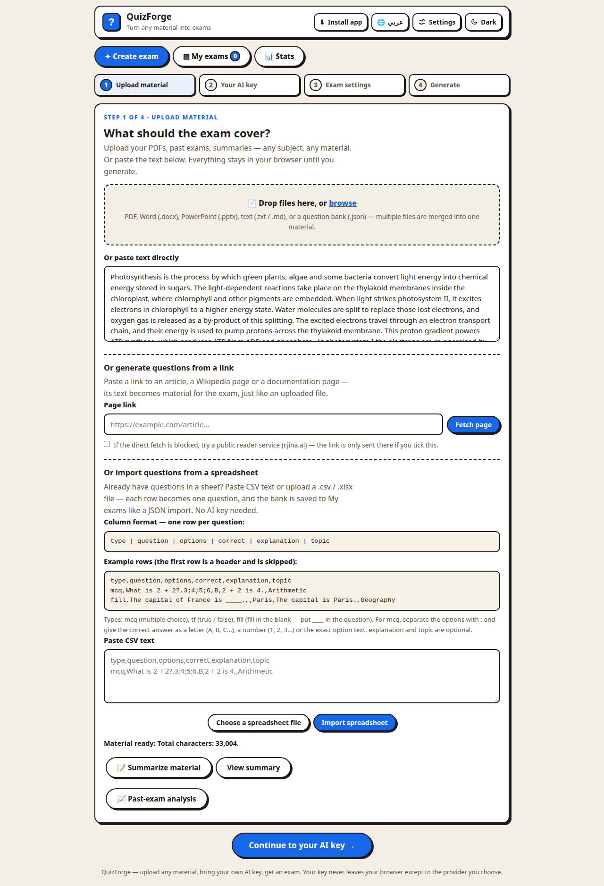
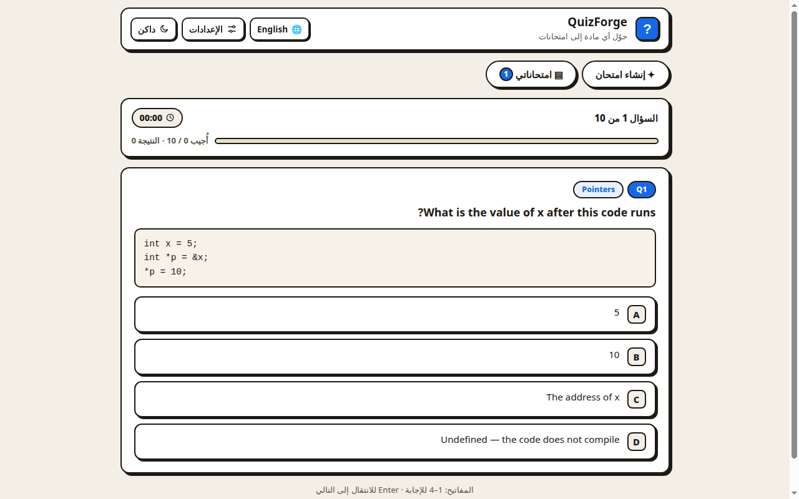
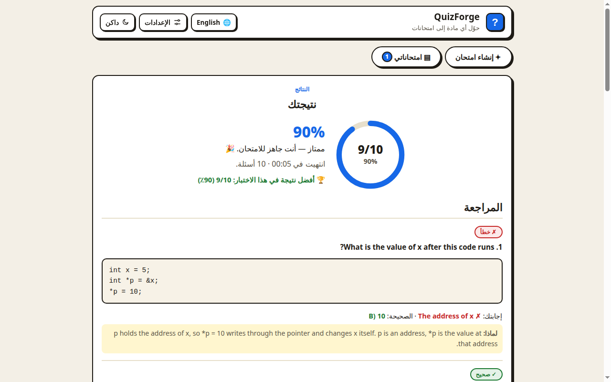

# QuizForge — Turn any material into exams

[](LICENSE)


QuizForge turns **any material into an exam** — any subject, any person.
Upload your PDFs, past exams, summaries or notes, paste in **your own**
AI API key, describe the exam you want, and get a ready-to-take quiz in
seconds. No account, no server, no build step: it is a static site that
runs entirely in your browser (and works on GitHub Pages for free).

It started as Practice Quiz Builder, a small quiz app with 10 verified
C pointers / linked-list questions. The quiz engine from that app —
timer, shuffle, instant explanations, review, retry-wrong-only, topics,
best score, dark mode — is still here, now as the player for every exam
QuizForge generates. The sample bank is kept as a built-in demo.

## Screenshots

| Upload material | Your AI key |
|---|---|
|  |  |

| Exam settings | My exams (library) |
|---|---|
|  |  |

It works on phones too — same flow, stacked layout:


The interface is fully bilingual — switch to Arabic from the header and the whole app flips to RTL:

| Start (Arabic) | Quiz (Arabic) | Results (Arabic) |
|---|---|---|
|  |  |  |

## How it works

1. **Upload material** — drag-and-drop or pick files: PDF, Word
   (`.docx`), PowerPoint (`.pptx`), text (`.txt` / `.md`), or a
   question bank (`.json`). Multiple files merge into one material.
   You can also paste text directly. PDF text is extracted in the
   browser with pdf.js (loaded lazily from a CDN the first time you
   add a PDF; plain text extraction only, no OCR). Word body text
   (paragraphs and tables, in order) and PowerPoint slide text (every
   slide, in slide-number order) are extracted in the browser with
   JSZip (loaded lazily from a CDN the first time you add a Word or
   PowerPoint file; plain text extraction only, no OCR — images,
   speaker notes and Word headers/footers are not read, and tracked
   deleted text is skipped). If a reader cannot load, the app tells
   you to paste the text instead and everything else keeps working
   offline.
2. **Your AI key** — pick a provider (Google Gemini, OpenAI, Anthropic
   Claude, or any OpenAI-compatible endpoint), paste your API key, pick
   a model, and press **Test connection**. You spend your own credits;
   QuizForge has no server and no account.
3. **Exam settings** — title/subject, 5–50 questions, question types
   (multiple choice with 4 options, True/False, or both), difficulty
   (Easy / Medium / Hard / Mixed), language (English / Arabic), focus
   notes ("focus on chapter 3, skip proofs"), and an optional
   per-question countdown.
4. **Generate** — the material is split into ~12,000-character chunks,
   questions are generated per chunk in sequence with a progress
   indicator ("Generating part 2 of 3…"), then merged, de-duplicated
   and shuffled. The exam is saved to **My exams** and you can take it
   right away with the full quiz engine.

**My exams** is your library: every generated or imported exam lives
there (on this device only) with Take / Export JSON / Delete. A valid
`.json` bank can be imported, and the built-in demo bank is always
there as a card: "Try the demo — no key needed".

**Sharing an exam** — every exam card, the exam start screen and the
results screen have a **🔗 Share via link** button. It packs the whole
exam into the link itself (`#exam=…` in the URL hash), so there is no
server involved and the link works from any static host. Anyone who
opens it gets the exam straight into the quiz — no files, no key.
Very large exams (over ~8 KB of link) cannot be shared this way and
the app says so with the size, instead of making a broken link; use
Export JSON for those.

**Smart review of mistakes** — after any quiz, the questions you got
wrong go into a persistent review queue (saved on this device, per
exam, so different exams never mix). A **🧠 Review mistakes** button
appears on the results screen, the exam start screen, and the exam's
card in My exams. In a review session each question must be answered
correctly **twice in a row** to leave the queue — the streak ("1 of 2
correct in a row") is shown on every question, and a wrong answer
resets it to zero. Reviewing never changes your saved exams or your
best score.

**Essay + fill-in-the-blank questions** — Step 3 offers two more
question types besides multiple choice and True/False. **Essay**
questions are free text: the student writes an answer and the AI
grades it against a short rubric the generator wrote, out of a max
score (5 by default), with one or two sentences of feedback. While
grading runs the question shows a clear "Grading your answer…" state.
If no API key is set, or grading fails, the app says so plainly and
shows the rubric instead — it never invents a grade. An essay counts
as correct at 60% of its max score. **Fill-in-the-blank** questions
are one sentence with a blank (`____`); the answer is checked locally
in the browser, immediately, against a list of accepted answers
(case-insensitive, extra spaces ignored) — no API call needed. Both
types mix freely with multiple-choice questions in one exam, appear
in results and review with the student's answer shown, can join the
smart-review queue when wrong (fill-in) or not passed (essay), count
in the stats dashboard like any other question, and print with blank
writing lines (essay) or the accepted answers in the key (fill-in).
The question-bank format documents both shapes (see below).

## Language — English / العربية

The header has a language toggle (🌐 عربي / English). Switching to
Arabic flips the whole interface to a right-to-left layout — header,
navigation, wizard, settings, library, quiz and results — and remembers
your choice on this device. You can switch language even mid-quiz; the
attempt and the per-question countdown keep running. The exam *content*
language (English/Arabic) is a separate choice in Step 3, so you can
have an Arabic interface generating an English exam, or the other way
round.

## Supported providers

| Provider | Default model | Notes |
|---|---|---|
| Google Gemini | `gemini-3.5-flash-lite` | Key in the URL (`?key=`), JSON mode. |
| OpenAI (ChatGPT) | `gpt-4o-mini` | Chat Completions, `response_format: json_object`. |
| Anthropic Claude | `claude-sonnet-5-5` | **Needs a CORS proxy** — see below. |
| Custom (OpenAI-compatible) | `gpt-4o-mini` | Any base URL + model, same shape as OpenAI. |

Model IDs change fast — every model field is editable, so if a
provider retires a model you can type the new ID in the same field.
Defaults were verified on 2026-11-20: `gemini-3.5-flash-lite` is the
Gemini default — Google retires `gemini-2.5-flash` on 2026-12-01 and
serves it only to projects that already used it, so a brand-new key
cannot call it; `gpt-4o-mini` still works but OpenAI retires it in January
2027; `claude-sonnet-4-5` is retired by Anthropic on 2026-11-30, so
the Claude default is its named replacement `claude-sonnet-5-5` —
do not use `claude-sonnet-4-5` after that date.

### Claude and CORS

Claude's API blocks direct calls from a browser page, so QuizForge
cannot call it without a CORS proxy. Add your proxy URL in Step 2 —
the proxy must forward the request to `https://api.anthropic.com` and
pass the `x-api-key` header through. Without a proxy, Claude shows a
plain message explaining this before any call is made. Gemini, OpenAI
and Custom endpoints work directly.

## Privacy

**Your key never leaves your browser except to the provider you
choose.** It is stored only on your own machine (localStorage), never
logged, and never shown in full — only the last 4 characters, e.g.
`••••••••1234`. Generated exams are also stored only locally. There is
no account, no analytics, no server receiving your material or your key.

## The quiz engine

Every exam plays in the same engine:

- **One question at a time**, progress bar, "Question 3 of 10" counter.
- **Timer** — total elapsed timer on every attempt, plus an optional
  per-question countdown (set the seconds in Settings).
- **Shuffle** — questions and answer options are shuffled (on by
  default). The correct answer is tracked through the shuffle, so the
  key never breaks.
- **Instant feedback + explanations** — pick an answer and see right
  away whether it was correct, with a "Why" explanation.
- **Results screen** — score ring with percentage, finish time, and a
  full review of every question. **Retry wrong answers only**
  re-quizzes just the ones you missed.
- **Smart review (spaced repetition)** — questions you miss join a
  persistent review queue (per exam, saved on this device). A
  "🧠 Review mistakes" button on the results screen, the exam start
  screen and the exam card opens a review session: each question must
  be answered correctly twice in a row to leave the queue, a wrong
  answer resets its streak to zero, and the streak is shown on every
  question. Reviewing never touches your saved exams or best score.
- **Flashcards** — a **🃏 Flashcards** button on every exam card, the exam start screen and the
  results screen opens a quick-revision deck built from the exam's own questions: tap a card (or
  press Space) to flip it and check the answer and explanation on the back. No score, no timer.
- **Strict exam mode** — an opt-in toggle on the exam start screen runs the exam under real
  exam rules: full screen, one fixed countdown for the whole exam, and forward-only navigation
  (no going back to a previous question). See [Strict exam mode](#strict-exam-mode) below.
- **Topic filter** — topic cards on the start screen, so you can drill
  one topic at a time.
- **Best score** — your best result for the current exam is saved in
  the browser and shown on the start screen.
- **Dark mode** — toggle in the header; your choice is remembered.
- **Keyboard shortcuts** — keys `1`–`4` pick an answer, `Enter` moves
  to the next question.
- **Print / save as PDF** — the "🖨 Print exam" button (on the exam
  start screen, the results screen, and every exam card in My exams)  prints the whole exam: all questions with their options, then an
  answer key with the correct answer and explanation on the last page.
  Use your browser's print dialog to save it as a PDF. The printout is
  always clean black-on-white (even in dark mode), questions are kept
  from splitting across pages where possible, and it works in Arabic
  too (RTL layout, code blocks stay left-to-right).
- **Printable answer sheet** — the "📝 Print answer sheet" button (same
  places as Print exam) builds a paper bubble sheet for a real exam
  room: exam title, blank Name / Date / Class fields, then one row per
  question — a bubble (○) for each answer option on multiple-choice
  questions, and lined write-in space for essay, fill-in, coding,
  matching and ordering questions. Same clean black-on-white print,
  page-break-safe rows, and RTL support as the exam printout.

## Stats dashboard

The **📊 Stats** tab in the header shows your progress across every
exam you take on this device:

- **Totals** — exams taken, questions answered, average score, and
  average time per question.
- **Accuracy by topic** — a bar per topic with correct/total, percentage,
  and average time, with your strongest topic and the one that needs
  the most work called out.
- **Recent attempts** — the last 8 attempts with date, exam, and score.

Every completed attempt is recorded automatically (exam, date, and
per-question results with topic and time spent) in localStorage under
`qf-stats`, keeping only the newest 50 attempts. A **Clear history**
button wipes it. With no attempts yet the dashboard shows a friendly
empty state, and damaged or older-shaped data is ignored safely. Works
in English and Arabic, in light and dark mode.

## Flashcards

The **🃏 Flashcards** button (on every exam card in My exams, the exam
start screen, and the results screen) opens a quick-revision deck for
that exam — including the demo bank, with no API key needed. Each card
shows the question on the front; flipping it reveals the correct
answer and explanation on the back (the rubric for essay questions,
the accepted answers for fill-in questions). Navigate with the
Previous/Next buttons or the arrow keys (they follow the page
direction in RTL), flip with a tap/click or Space/Enter, and reshuffle
the deck with the Shuffle toggle. Works in English and Arabic, in
light and dark mode.

## Read questions aloud

Every question has a **🔊 Listen** button — on the quiz screen, on the
front of each flashcard, and on every row of the results review — that
reads the question aloud using your browser's built-in speech
(`window.speechSynthesis`): on-device, no network, no API key. While
it speaks, the button becomes a **⏹ Stop** button.

- Multiple choice and True/False questions are read with their
  on-screen letters (A, B, C…) in the order shown; matching reads the
  left items then the right partners in their displayed order, and
  ordering reads the items in their current on-screen order — never
  paired or in the correct order, so the answer is never given away.
  Essay and fill-in questions read the question text only; coding
  questions never read code aloud.
- **Settings** has an auto-read toggle (off by default) that reads each
  new question automatically as it appears, and a reading-speed
  selector (Slow / Normal / Fast). Both are saved on the device.
- The voice follows the exam's language — Arabic-script questions are
  read with an Arabic voice, English ones with an English voice (a
  matching voice is picked when the browser has one, otherwise the
  browser default speaks).
- Speech always stops when you move on: next question, submit, leaving
  the quiz, starting a review session, switching the UI language
  mid-quiz, or changing view. If your browser does not support reading
  aloud, no speaker button is shown and Settings says so plainly.

## Strict exam mode

Turn on **Strict exam mode** on the exam start screen (off by default,
per exam) to take the exam under real exam rules:

- **Full screen** is requested when the exam starts. If the browser
  denies it, the exam still runs under the same rules — nothing else
  changes.
- **One fixed countdown for the whole exam** — the total is the
  per-question time from Settings multiplied by the number of
  questions (60 seconds per question when the per-question timer is
  off). When it reaches zero the exam submits automatically with
  whatever is answered; unanswered questions count as wrong.
- **Forward-only navigation** — there is no back button, no question
  list to jump back to, and no way to revisit a previous question.
- **Leaving full screen mid-exam shows one warning** — it never
  auto-fails you; the exam continues.
- The results screen says the exam **was taken in strict mode**, and
  the attempt is marked as strict in the stats history.

Strict mode works for every question type (multiple choice, essay,
fill-in, coding) and never touches review sessions or the normal quiz flow —
turning it off is just leaving the toggle off.

## Coding questions

Step 3 offers a **Coding** question type. A coding question is a
programming task in **JavaScript only** — the app says so plainly in
the settings, and the generator is told to use JavaScript and nothing
else. Other languages are not offered, because there is no reliable
way to run them inside this static app; a coding question that asks
for another language is rejected on import/generation instead of
pretending to work.

- **In the quiz**, a coding question shows a monospace code editor
  prefilled with the starter code. Press **Run tests** to check your
  code without submitting, fix it, and run again — then press
  **Submit code**. Each test shows pass/fail with its input, the
  expected output, and what your code actually produced (or the error
  message, if it crashed).
- **How it runs** — your code executes in your browser, inside a Web
  Worker: the worker has no DOM and no access to the page or to
  QuizForge's own state, so student code cannot read or change the
  app. If the code does not finish within 3 seconds (for example an
  infinite loop), the worker is killed and the tests report a timeout
  instead of hanging the page. If the browser cannot start a worker,
  the same runner falls back to the main thread and the app warns you
  that a loop may freeze the page there.
- **Grading** — by the fraction of tests passed; a coding question
  counts as correct only when every test passes. Your code, the
  per-test results, and the test score appear in the results review,
  and a failed coding question joins the smart-review queue like any
  other missed question. It also counts in the stats dashboard, shows
  its tests on the back of flashcards, and prints with its starter
  code and its tests (input → expected) plus the tests in the answer
  key.

## Matching + ordering questions

Step 3 offers two more question types: **Matching** and **Ordering**.

- **Matching** — two columns to connect: each left item (a term) gets a
  dropdown of the right-side partners (definitions), shuffled so the
  partners never sit next to their own item. Pick a partner for every
  item, then submit.
- **Ordering** — a list of steps to put in the right order, moved with
  simple ↑ / ↓ buttons (no drag-and-drop, so it works the same on
  touch, mouse, and keyboard).
- **Grading** — by fraction, shown honestly: matching counts the correct
  pairs ("2 of 3 pairs correct"), ordering counts the items in the
  correct position ("2 of 3 in the right place"). A question counts as
  fully correct only when every pair matches / the whole order is
  right — partial credit is never rounded up to a pass. The results
  review shows your pairs / order next to the correct ones, a wrong
  matching or ordering question joins the smart-review queue, it counts
  in the stats dashboard, flashcards show the correct pairs / order on
  the back, and the print sheet lists the pairs (left numbered, right
  lettered) and the steps to number, with both answers in the key.

## Material summary

Before generating the exam, you can read a summary of your material
first. On step 1 (Upload material), press **Summarize material**: the
app asks your AI provider — the same key as exam generation — for the
material's key points plus definitions of its important terms, and
shows them on their own screen. Read it, then continue to exam
settings and generate as usual.

- Long material is summarized in the same chunks as exam generation
  (12,000 characters each), and repeated points and terms are merged.
- The summary is saved with the exam in My exams. Open any exam that
  has one and press **View summary** on its start screen to re-read it.
- With no API key set, or if the provider call fails, you get a clear
  message instead — no summary is ever invented or made up.
- If you change the material after summarizing, the summary is dropped
  so it can never describe material it was not made from; summarize
  again for the new material.
- Summaries are not included in share links, so a shared exam link
  stays under the size limit.

## Exam translation

On the start screen — and again on the results screen — press
**Translate exam**: the whole exam's content is translated in one
tap, from English to Arabic or Arabic to English, using your own AI
provider and the same key as exam generation. Press the button again
to switch back to the original — the original text is kept untouched,
and toggling back restores it exactly.

- Translated: question text, answer options, explanations, essay
  rubrics, matching pairs (both sides) and ordering items.
- Never translated: code snippets, coding starter code, test inputs
  and expected outputs, fill-in accepted answers, topics (they are
  the filter and stats keys), and the exam title / subtitle (they
  are the best-score / library identity). Numbers and code-like
  options come back unchanged.
- The answer key never moves: options keep their order, so the
  correct-option index, matching pairs, ordering items, fill-in
  answers and coding tests all grade exactly as before. A translated
  exam runs end to end — quiz, results, review, stats, print, share
  link and flashcards all show the translated text; sharing or
  saving while translated shares the translated text.
- Exam content language is independent of the UI language:
  translating the exam never changes the UI language, and switching
  the UI language never re-translates the exam.
- With no API key set, or if the provider call fails, you get a
  clear message instead — no fake translation, and no
  half-translated exam: if any part of the translation fails, the
  original stays intact.

## Spreadsheet import

On step 1 of the wizard you can import questions from a spreadsheet
instead of generating them: paste CSV text or upload a `.csv` /
`.xlsx` file. Each row becomes one question, and the bank is saved
to My exams like a JSON import — no AI key needed. One row per
question, in this column format:

```
type,question,options,correct,explanation,topic
mcq,What is 2 + 2?,3;4;5;6,B,2 + 2 is 4.,Arithmetic
fill,The capital of France is ____.,,Paris,The capital is Paris.,Geography
```

- `type` is `mcq` (multiple choice), `tf` (true / false) or `fill`
  (fill in the blank — put `____` in the question). It defaults to
  `mcq` when left blank.
- `options` are separated by `;`. For `mcq`, `correct` is a letter
  (`A`, `B`, `C`…), a 1-based number, or the exact option text. For
  `tf` it is `True` / `False`. For `fill` it is the accepted
  answer(s), separated by `;`.
- `explanation` and `topic` are optional. A sheet with one option
  per column (`type, question, option…, correct, explanation, topic`)
  works too.
- The first row is treated as a header and skipped. Every row is
  checked with the same validation as a JSON import: bad rows are
  reported by row number with a reason and skipped, and a file with
  no valid rows imports nothing.
- `.xlsx` files load the SheetJS library lazily from a CDN the first
  time one is added (same pattern as pdf.js). If the CDN cannot be
  reached you get a clear message and CSV paste / upload keep
  working.
- `.docx` / `.pptx` files load the JSZip library lazily from a CDN
  the first time one is added (same pattern as pdf.js). If the CDN
  cannot be reached you get a clear message and paste / other uploads
  keep working. A file that is not a real Word/PowerPoint file, a
  presentation with no slides, or a file with no readable text shows
  a clear error and adds nothing.

## Library backup

In **My exams**, press **💾 Export library (.json)** to download one
JSON file holding your whole library — every saved exam with its
questions and its material summary (when it has one) — plus a version
marker and the export date. Press **📥 Import library (.json)** on
any device or browser to bring a backup back: every exam in the file
is checked with the same validation as a single-exam import, exams
already in your library (same id) are skipped, and the rest are added
— then you get a clear count of how many were added and how many
were already there.

- A corrupt file, a file that is not a QuizForge library backup, or a
  file with no valid exams shows a clear error and changes nothing:
  your existing library is never wiped by a failed import.
- A backup file is just JSON, so you can move it by email, chat, or
  a USB stick. It holds exams only — not your API key, settings,
  best scores, review queue, or stats, which stay on the device
  where they were made.

## Offline mode — install it like an app

QuizForge is a progressive web app: a service worker caches the whole
app shell (page, scripts, styles, demo bank, manifest, icon), so once
you have opened it once, it loads and works with no connection at
all. On a phone or desktop browser that supports it you can install
it from the **Install app** button in the header (it only appears
when the browser offers installation) and launch it like a native
app.

- **Works offline:** the demo bank, your saved exams in My exams,
  taking a quiz, smart review, stats, flashcards, strict exam mode,
  printing, and opening a shared exam link — all local, all offline.
  A small bar under the header tells you when you are offline.
- **Needs internet, and says so:** AI exam generation, translation,
  material summary, essay grading, and the first-time load of the
  PDF reader (pdf.js), spreadsheet reader (SheetJS) and Word /
  PowerPoint reader (JSZip) all need a connection. Offline, each one
  shows a clear "you are offline" message instead of failing silently
  or inventing an answer.
- The cache is versioned (`quizforge-v1` in `sw.js`): when the app
  updates, the new service worker replaces the old cache cleanly.
  Opening the app over `file://` skips service-worker registration
  entirely and the app works exactly as before.

## Project structure

```
index.html            — the app shell (header, nav, wizard mount point)
app.js                — everything: wizard, providers, generation, library, quiz engine
style.css             — all styling: beige identity, dark mode, responsive layout
questions.json        — the built-in demo bank (10 C pointers / linked-list MCQ)
docs/screenshots/     — real screenshots of the app (desktop + mobile)
CHANGELOG.md          — what changed in each update
LICENSE               — MIT
```

## How to use it

1. **Run it locally.** Browsers block `fetch()` from `file://`, so serve
   the folder with a tiny local server (from inside this folder):

   ```bash
   python3 -m http.server 8000
   ```

   Then open <http://localhost:8000> in your browser.
   (`npx serve .` or VS Code's Live Server work too.)

2. **Create an exam.** Upload your material, add your API key, set the
   exam details, and press **Generate my exam**. Take it right away, or
   find it later in **My exams**.

3. **Or take the demo.** In **My exams**, press **Take the demo exam** —
   10 verified questions on C pointers and linked lists, no key needed.

## Question-bank format

Generated and imported exams use the same JSON format:

```json
{
  "title": "My Quiz",
  "subtitle": "A short line shown under the title",
  "questions": [
    {
      "question": "What is 2 + 2?",
      "code": "optional code snippet shown above the options",
      "topic": "Arithmetic",
      "difficulty": "Easy",
      "options": ["3", "4", "5", "6"],
      "answer": 1,
      "explanation": "2 + 2 is 4. A short reason is more useful than just the letter."
    }
  ]
}
```

Rules: `options` needs at least 2 entries (4 for multiple choice, 2 —
`"True"` / `"False"` — for True/False), and `answer` is the **0-based**
index of the correct option (so `1` means the second option). `code`,
`topic`, `difficulty` and `explanation` are optional — but
`explanation` is the part that actually teaches, so a good one matters,
and `topic` is what powers the topic cards.

Two more shapes use the same array — set `"type"` on the question:

```json
{
  "question": "Explain in two or three sentences why photosynthesis matters for life on Earth.",
  "type": "essay",
  "rubric": "Mentions that photosynthesis produces oxygen and glucose; links both to life on Earth.",
  "maxScore": 5,
  "topic": "Photosynthesis",
  "difficulty": "Medium",
  "explanation": "Photosynthesis is the base of nearly every food chain and the source of the oxygen we breathe."
},
{
  "question": "Photosynthesis takes place in the ____ of the plant cell.",
  "type": "fill",
  "answers": ["chloroplast", "chloroplasts"],
  "topic": "Photosynthesis",
  "difficulty": "Easy",
  "explanation": "Chloroplasts hold the chlorophyll that captures light energy."
}
```

Rules: an essay needs a `"rubric"` (short grading text) and takes an
optional `"maxScore"` (1–100, default 5); it is graded by the AI and
counts as correct at 60% of its max. A fill-in-the-blank needs an
`"answers"` array with at least one accepted answer and exactly one
blank written as `____` in the question text; it is checked locally,
case-insensitively. Neither shape has `"options"` or `"answer"`.
Questions with no `"type"` are treated as multiple choice (or
True/False when they have exactly 2 options), so older banks keep
working unchanged.

A coding question is the same array with `"type": "coding"` —
**JavaScript only**:

```json
{
  "question": "Write a function sum(a, b) that returns the sum of its two numbers.",
  "type": "coding",
  "language": "JavaScript",
  "starterCode": "function sum(a, b) {\n  // write your code here\n}",
  "tests": [
    { "input": "sum(2, 3)", "expected": "5" },
    { "input": "sum(-1, 1)", "expected": "0" }
  ],
  "topic": "Functions",
  "difficulty": "Easy",
  "explanation": "The function must return a + b for any two numbers."
}
```

Rules: `"language"` must be `"JavaScript"` (any other language is
rejected — it cannot run in the browser). `"starterCode"` is the code
the student starts from, and `"tests"` is an array of 1 or more tests,
each with `"input"` — a JavaScript expression that calls the student's
function, e.g. `"sum(2, 3)"` — and `"expected"` — the exact result as
a string, e.g. `"5"`. The student's code runs in a Web Worker against
those tests (3-second timeout, so an infinite loop is stopped, not
hung); a question counts as correct only when every test passes.

A matching question has "type": "matching" and a "pairs" array
of 2 or more objects, each with "left" and "right" (the right
value is the correct partner for that left value); every left and
right value must be unique. An ordering question has
"type": "ordering" and an "items" array of 2 or more unique
strings in the **correct** order. Neither shape has "options" or
"answer".

```json
{
  "question": "Match each pointer term with its correct meaning.",
  "type": "matching",
  "pairs": [
    { "left": "int *p", "right": "A pointer that holds the address of an int" },
    { "left": "&x", "right": "The address of x" },
    { "left": "*p", "right": "The value stored at the address p points to" }
  ],
  "topic": "Pointers",
  "difficulty": "Easy",
  "explanation": "The * in a declaration makes p a pointer, & takes an address, and * follows the pointer to its value."
}
```

## Deploy it free

**GitHub Pages** (simplest):

1. Push this folder to a public GitHub repository.
2. Go to the repo's **Settings → Pages**.
3. Under "Build and deployment", choose **Deploy from a branch**, branch
   `main`, folder `/ (root)`.
4. Your app is live at `https://<username>.github.io/<repo-name>/` within
   a minute or two.

It also works as a static site on Netlify Drop, Vercel, or Cloudflare Pages —
just upload the folder. Note: PDF reading loads pdf.js from cdnjs the
first time a PDF is added, and Word/PowerPoint reading loads JSZip
from cdnjs the first time a .docx or .pptx file is added, so those
steps need internet; the demo bank and everything else work fully
offline once loaded.

## Contributing

Pull requests are welcome. If you add questions, please keep the same
bar as the sample bank: every answer checked (run the code when the
question has code), four options for MCQ, a `topic`, and a real
explanation — not just the correct letter. See
[CHANGELOG.md](CHANGELOG.md) for what changed in each update.

## License

MIT — see [LICENSE](LICENSE).
