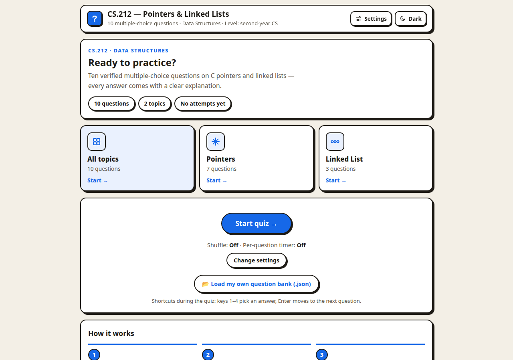

# Practice Quiz Builder

[](LICENSE)


A tiny, dependency-free practice quiz app: one HTML file, one CSS file, one
JSON file. Edit `questions.json`, open the page, and you have an interactive
multiple-choice quiz with instant feedback, explanations, and a final score —
no build step, no framework, no server code, no account.

## Why this exists

Built by Bassem Estawar, a second-year Computer Science student at
Misr University for Science and Technology (MUST). During exam season he makes
study summaries from course PDFs and turns them into small practice-question
websites that his classmates use to revise. This repo is the reusable template
behind those pages, so anyone can make the same kind of quiz for any subject.

The sample bank included here is 10 multiple-choice questions on **C pointers
and linked lists** (CS.212 Data Structures level) — the topic that carried the
most marks in his own course quiz. Every answer was checked by compiling and
running the code snippets.

## Screenshots

| Start screen | Question |
|---|---|
|  |  |

| Results | Dark mode |
|---|---|
|  |  |

It works on phones too — same screens, stacked layout:


## Features

- **Dashboard start screen** — stat chips (questions, topics, best score),
  topic cards you tap to start that topic right away, a big Start button,
  and a "How it works" strip.
- **One question at a time**, with a progress bar and a "Question 3 of 10"
  counter in the top bar.
- **Timer** — a total elapsed timer on every attempt, plus an optional
  per-question countdown (off by default; set the seconds in Settings).
  Running out of time marks the question wrong and shows the correct answer.
- **Shuffle** — questions and answer options are shuffled (on by default).
  The correct answer is tracked through the shuffle, so the key never breaks.
- **Instant feedback + explanations** — pick an answer and see right away
  whether it was correct, with a "Why" explanation.
- **Results screen** — a score ring with your percentage, finish time, and a
  full review of every question: your answer vs the correct answer, with the
  explanation. A **Retry wrong answers only** button re-quizzes just the
  ones you missed.
- **Topic filter** — topic cards on the start screen (e.g. Pointers,
  Linked List) so you can drill one topic at a time.
- **Settings panel** — shuffle and the per-question countdown live in a
  dropdown in the header, openable from anywhere; the start screen shows a
  live summary of your current settings.
- **Best score** — your best result for the current bank is saved in the
  browser (localStorage) and shown on the start screen.
- **Dark mode** — toggle in the header; your choice is remembered. A dark
  version of the same beige/blue identity.
- **Keyboard shortcuts** — keys `1`–`4` pick an answer, `Enter` moves to the
  next question.
- **Load your own bank** — pick any `.json` file in the same format from the
  start screen. A bad file shows a clear error instead of breaking the page,
  and you can restore the sample bank with one click.
- **Settings persist** — shuffle and timer choices are remembered on the
  device.

## Project structure

```
index.html            — the app (HTML + JavaScript, no build step)
style.css             — all styling: beige identity, dark mode, responsive layout
questions.json        — the sample question bank (10 C pointers / linked-list MCQ)
docs/screenshots/     — real screenshots of the app (desktop + mobile, light + dark)
CHANGELOG.md          — what changed in each daily update
LICENSE               — MIT
```

## How to use it

1. **Run it locally.** Browsers block `fetch()` from `file://`, so serve the
   folder with a tiny local server (from inside this folder):

   ```bash
   python3 -m http.server 8000
   ```

   Then open <http://localhost:8000> in your browser.
   (`npx serve .` or VS Code's Live Server work too.)

2. **Take the quiz.** Pick a topic (or All), check the settings you want,
   and press **Start quiz**. Click an answer — or press `1`–`4` — to get
   instant feedback and an explanation, then press `Enter` (or Next) to move
   on. At the end you get your score, a full review, and the option to retry
   only the questions you got wrong.

3. **Make your own quiz.** Open `questions.json` and replace the questions,
   or load any bank in the same format from the start screen. The format is:

   ```json
   {
     "title": "My Quiz",
     "subtitle": "A short line shown under the title",
     "questions": [
       {
         "question": "What is 2 + 2?",
         "code": "optional code snippet shown above the options",
         "topic": "Arithmetic",
         "options": ["3", "4", "5", "6"],
         "answer": 1,
         "explanation": "2 + 2 is 4. A short reason is more useful than just the letter."
       }
     ]
   }
   ```

   Rules: `options` needs at least 2 entries, and `answer` is the **0-based**
   index of the correct option (so `1` means the second option). `code`,
   `topic`, and `explanation` are optional — but `explanation` is the part
   that actually teaches, so write it properly, and `topic` is what powers
   the topic cards.

## Deploy it free

**GitHub Pages** (simplest):

1. Push this folder to a public GitHub repository.
2. Go to the repo's **Settings → Pages**.
3. Under "Build and deployment", choose **Deploy from a branch**, branch
   `main`, folder `/ (root)`.
4. Your quiz is live at `https://<username>.github.io/<repo-name>/` within a
   minute or two.

It also works as a static site on Netlify Drop, Vercel, or Cloudflare Pages —
just upload the folder.

## Contributing

Pull requests are welcome. If you add questions, please keep the same bar as
the sample bank: every answer checked (run the code when the question has
code), four options, a `topic`, and a real explanation — not just the correct
letter. See [CHANGELOG.md](CHANGELOG.md) for what changed in each daily
update.

## License

MIT — see [LICENSE](LICENSE).
