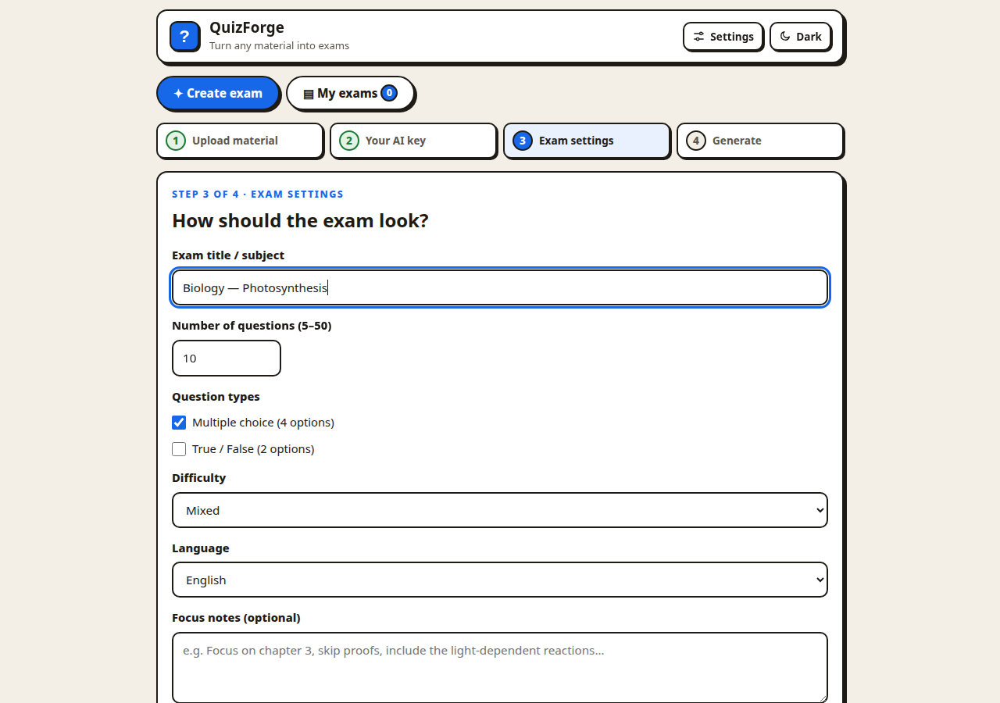

# QuizForge — Turn any material into exams

[](LICENSE)


QuizForge turns **any material into an exam** — any subject, any person.
Upload your PDFs, past exams, summaries or notes, paste in **your own**
AI API key, describe the exam you want, and get a ready-to-take quiz in
seconds. No account, no server, no build step: it is a static site that
runs entirely in your browser (and works on GitHub Pages for free).

It started as Practice Quiz Builder, a small quiz app with 10 verified
C pointers / linked-list questions. The quiz engine from that app —
timer, shuffle, instant explanations, review, retry-wrong-only, topics,
best score, dark mode — is still here, now as the player for every exam
QuizForge generates. The sample bank is kept as a built-in demo.

## Screenshots

| Upload material | Your AI key |
|---|---|
|  |  |

| Exam settings | My exams (library) |
|---|---|
|  |  |

It works on phones too — same flow, stacked layout:


## How it works

1. **Upload material** — drag-and-drop or pick files: PDF, text
   (`.txt` / `.md`), or a question bank (`.json`). Multiple files merge
   into one material. You can also paste text directly. PDF text is
   extracted in the browser with pdf.js (loaded lazily from a CDN the
   first time you add a PDF; plain text extraction only, no OCR). If
   the reader cannot load, the app tells you to paste the text instead
   and everything else keeps working offline.
2. **Your AI key** — pick a provider (Google Gemini, OpenAI, Anthropic
   Claude, or any OpenAI-compatible endpoint), paste your API key, pick
   a model, and press **Test connection**. You spend your own credits;
   QuizForge has no server and no account.
3. **Exam settings** — title/subject, 5–50 questions, question types
   (multiple choice with 4 options, True/False, or both), difficulty
   (Easy / Medium / Hard / Mixed), language (English / Arabic), focus
   notes ("focus on chapter 3, skip proofs"), and an optional
   per-question countdown.
4. **Generate** — the material is split into ~12,000-character chunks,
   questions are generated per chunk in sequence with a progress
   indicator ("Generating part 2 of 3…"), then merged, de-duplicated
   and shuffled. The exam is saved to **My exams** and you can take it
   right away with the full quiz engine.

**My exams** is your library: every generated or imported exam lives
there (on this device only) with Take / Export JSON / Delete. A valid
`.json` bank can be imported, and the built-in demo bank is always
there as a card: "Try the demo — no key needed".

## Supported providers

| Provider | Default model | Notes |
|---|---|---|
| Google Gemini | `gemini-3.5-flash-lite` | Key in the URL (`?key=`), JSON mode. |
| OpenAI (ChatGPT) | `gpt-4o-mini` | Chat Completions, `response_format: json_object`. |
| Anthropic Claude | `claude-sonnet-5-5` | **Needs a CORS proxy** — see below. |
| Custom (OpenAI-compatible) | `gpt-4o-mini` | Any base URL + model, same shape as OpenAI. |

Model IDs change fast — every model field is editable, so if a
provider retires a model you can type the new ID in the same field.
Defaults were verified on 2026-11-20: `gemini-3.5-flash-lite` is the
Gemini default — Google retires `gemini-2.5-flash` on 2026-12-01 and
serves it only to projects that already used it, so a brand-new key
cannot call it; `gpt-4o-mini` still works but OpenAI retires it in January
2027; `claude-sonnet-4-5` is retired by Anthropic on 2026-11-30, so
the Claude default is its named replacement `claude-sonnet-5-5` —
do not use `claude-sonnet-4-5` after that date.

### Claude and CORS

Claude's API blocks direct calls from a browser page, so QuizForge
cannot call it without a CORS proxy. Add your proxy URL in Step 2 —
the proxy must forward the request to `https://api.anthropic.com` and
pass the `x-api-key` header through. Without a proxy, Claude shows a
plain message explaining this before any call is made. Gemini, OpenAI
and Custom endpoints work directly.

## Privacy

**Your key never leaves your browser except to the provider you
choose.** It is stored only on your own machine (localStorage), never
logged, and never shown in full — only the last 4 characters, e.g.
`••••••••1234`. Generated exams are also stored only locally. There is
no account, no analytics, no server receiving your material or your key.

## The quiz engine

Every exam plays in the same engine:

- **One question at a time**, progress bar, "Question 3 of 10" counter.
- **Timer** — total elapsed timer on every attempt, plus an optional
  per-question countdown (set the seconds in Settings).
- **Shuffle** — questions and answer options are shuffled (on by
  default). The correct answer is tracked through the shuffle, so the
  key never breaks.
- **Instant feedback + explanations** — pick an answer and see right
  away whether it was correct, with a "Why" explanation.
- **Results screen** — score ring with percentage, finish time, and a
  full review of every question. **Retry wrong answers only**
  re-quizzes just the ones you missed.
- **Topic filter** — topic cards on the start screen, so you can drill
  one topic at a time.
- **Best score** — your best result for the current exam is saved in
  the browser and shown on the start screen.
- **Dark mode** — toggle in the header; your choice is remembered.
- **Keyboard shortcuts** — keys `1`–`4` pick an answer, `Enter` moves
  to the next question.

## Project structure

```
index.html            — the app shell (header, nav, wizard mount point)
app.js                — everything: wizard, providers, generation, library, quiz engine
style.css             — all styling: beige identity, dark mode, responsive layout
questions.json        — the built-in demo bank (10 C pointers / linked-list MCQ)
docs/screenshots/     — real screenshots of the app (desktop + mobile)
CHANGELOG.md          — what changed in each update
LICENSE               — MIT
```

## How to use it

1. **Run it locally.** Browsers block `fetch()` from `file://`, so serve
   the folder with a tiny local server (from inside this folder):

   ```bash
   python3 -m http.server 8000
   ```

   Then open <http://localhost:8000> in your browser.
   (`npx serve .` or VS Code's Live Server work too.)

2. **Create an exam.** Upload your material, add your API key, set the
   exam details, and press **Generate my exam**. Take it right away, or
   find it later in **My exams**.

3. **Or take the demo.** In **My exams**, press **Take the demo exam** —
   10 verified questions on C pointers and linked lists, no key needed.

## Question-bank format

Generated and imported exams use the same JSON format:

```json
{
  "title": "My Quiz",
  "subtitle": "A short line shown under the title",
  "questions": [
    {
      "question": "What is 2 + 2?",
      "code": "optional code snippet shown above the options",
      "topic": "Arithmetic",
      "difficulty": "Easy",
      "options": ["3", "4", "5", "6"],
      "answer": 1,
      "explanation": "2 + 2 is 4. A short reason is more useful than just the letter."
    }
  ]
}
```

Rules: `options` needs at least 2 entries (4 for multiple choice, 2 —
`"True"` / `"False"` — for True/False), and `answer` is the **0-based**
index of the correct option (so `1` means the second option). `code`,
`topic`, `difficulty` and `explanation` are optional — but
`explanation` is the part that actually teaches, so a good one matters,
and `topic` is what powers the topic cards.

## Deploy it free

**GitHub Pages** (simplest):

1. Push this folder to a public GitHub repository.
2. Go to the repo's **Settings → Pages**.
3. Under "Build and deployment", choose **Deploy from a branch**, branch
   `main`, folder `/ (root)`.
4. Your app is live at `https://<username>.github.io/<repo-name>/` within
   a minute or two.

It also works as a static site on Netlify Drop, Vercel, or Cloudflare Pages —
just upload the folder. Note: PDF reading loads pdf.js from cdnjs the
first time a PDF is added, so that one step needs internet; the demo
bank and everything else work fully offline once loaded.

## Contributing

Pull requests are welcome. If you add questions, please keep the same
bar as the sample bank: every answer checked (run the code when the
question has code), four options for MCQ, a `topic`, and a real
explanation — not just the correct letter. See
[CHANGELOG.md](CHANGELOG.md) for what changed in each update.

## License

MIT — see [LICENSE](LICENSE).
